# Principles and Development of Nucleic Acid Sequencing Technologies

## Timeline of Sequencing Technology Development

| Date | Milestone |
| --- | --- |
| 1953-04 | Watson and Crick proposed the DNA double helix, supported by X-ray diffraction studies by Franklin and Gosling and by Wilkins and colleagues. [[1]](#ref-1), [[2]](#ref-2), [[3]](#ref-3) |
| 1965-03 | Holley and colleagues reported the complete sequence of yeast alanine transfer RNA. [[4]](#ref-4) |
| 1975-05 | Sanger and Coulson introduced the plus-and-minus sequencing method. [[5]](#ref-5) |
| 1977-02 | Maxam and Gilbert introduced base-selective chemical cleavage sequencing. [[6]](#ref-6) |
| 1977-12 | Sanger, Nicklen, and Coulson introduced dideoxy chain-termination sequencing. [[7]](#ref-7) |
| 1986-06 | Smith and colleagues demonstrated fluorescence detection for automated DNA sequencing. [[8]](#ref-8) |
| 1987-10 | Prober and colleagues introduced fluorescent chain-terminating ddNTPs for single-reaction sequencing. [[9]](#ref-9) |
| 1990-03 | Swerdlow and Gesteland demonstrated capillary gel electrophoresis for rapid, high-resolution separation of sequencing fragments. [[10]](#ref-10) |
| 1996-11 | Ronaghi and colleagues demonstrated real-time sequencing by detecting pyrophosphate release. [[11]](#ref-11) |
| 2004-10 | The International Human Genome Sequencing Consortium reported the finished euchromatic human genome sequence. [[12]](#ref-12) |
| 2005-07 | Margulies and colleagues reported massively parallel bead-based pyrosequencing in picolitre reactors, establishing the 454 platform. [[13]](#ref-13) |
| 2005-12 | Solexa publicly introduced its Genome Analysis System, combining clonal clusters with reversible-terminator SBS. |
| 2008-05 | Valouev and colleagues demonstrated genome-scale SOLiD ligation sequencing with two-base encoding. [[14]](#ref-14) |
| 2008-11 | Bentley and colleagues demonstrated accurate human whole-genome sequencing using reversible-terminator SBS. [[15]](#ref-15) |
| 2008-11 | Eid and colleagues demonstrated real-time sequencing from individual polymerases in zero-mode waveguides. [[16]](#ref-16) |
| 2009-08 | Pushkarev and colleagues sequenced a human genome with the Helicos single-molecule platform. [[17]](#ref-17) |
| 2009-11 | Drmanac and colleagues reported DNA nanoball arrays with combinatorial probe-anchor ligation (cPAL). [[18]](#ref-18) |
| 2010-01 | Illumina introduced HiSeq 2000 for high-throughput SBS. |
| 2010-02 | Pacific Biosciences announced early access to its SMRT sequencing system, PacBio RS. |
| 2011-07 | Rothberg and colleagues described Ion Torrent semiconductor sequencing based on incorporation-associated hydrogen-ion release. [[19]](#ref-19) |
| 2012-02 | Oxford Nanopore presented MinION and GridION together with nanopore sequencing data at AGBT. |
| 2013-11 | Oxford Nanopore opened registration for the MinION Access Programme. |
| 2014-01 | Illumina introduced the NextSeq 500 and HiSeq X Ten systems. |
| 2015-09 | Pacific Biosciences introduced Sequel, expanding SMRT sequencing capacity. |
| 2017-01 | Illumina introduced the NovaSeq series for higher-throughput SBS. |
| 2018-10 | MGI introduced MGISEQ-T7, subsequently named DNBSEQ-T7, with four independently operated flow cells. |
| 2019-04 | PacBio introduced Sequel II and SMRT Cell 8M. |
| 2019-08 | Wenger and colleagues demonstrated accurate circular consensus long reads for human variant detection and genome assembly. [[20]](#ref-20) |
| 2021-12 | Oxford Nanopore announced Kit 12 and R10.4 flow cells, supporting Q20+ and duplex sequencing. |
| 2022-03 | Element Biosciences introduced AVITI with avidity-based sequencing. |
| 2022-03 | The Telomere-to-Telomere Consortium reported the CHM13 assembly, with gapless sequences for all chromosomes except Y. [[21]](#ref-21) |
| 2022-05 | Ultima Genomics introduced its open-wafer sequencing architecture and flow-based, mostly natural SBS. |
| 2022-09 | Illumina introduced the NovaSeq X series and XLEAP-SBS chemistry. |
| 2022-10 | PacBio announced Revio for HiFi sequencing and Onso for short-read sequencing by binding. |
| 2023-02 | MGI announced DNBSEQ-T20×2 at AGBT. |
| 2023-05 | The Human Pangenome Reference Consortium reported a draft human pangenome based on phased diploid assemblies. [[22]](#ref-22) |
| 2023-05 | Arslan and colleagues described avidity sequencing using multivalent fluorescent reagents for base recognition. [[23]](#ref-23) |
| 2024-10 | Illumina introduced the MiSeq i100 series of benchtop SBS instruments. |
| 2024-11 | PacBio announced Vega for benchtop HiFi sequencing. |
| 2025-02 | Roche introduced sequencing by expansion (SBX), encoding template sequences into expanded polymers for nanopore detection. [[24]](#ref-24) |
| 2025-10 | PacBio announced SPRQ-Nx development for Revio and Vega. |
| 2026-02 | Element Biosciences announced the VITARI high-throughput benchtop sequencing platform. |
| 2026-02 | Ultima announced the UG200 series and Solaris 2.0 workflows. |
| 2026-05 | Oxford Nanopore presented PromethION Plus flow-cell developments and updates to RNA and base-modification sequencing. |
| 2026-06 | Roche announced AXELIOS 1, implementing nanopore detection of SBX reporter polymers. |
| 2026-08 | PacBio announced SPRQ-Nx and software updates for Vega. |

## First-Generation Sequencing

### Chain-Termination Sequencing (Sanger)

Sanger sequencing uses DNA polymerase to extend a primer in the presence of normal deoxynucleoside triphosphates (dNTPs) and chain-terminating 2′,3′-dideoxynucleoside triphosphates (ddNTPs). Once a complementary ddNTP is incorporated, the absence of a 3′-hydroxyl group prevents formation of the next phosphodiester bond. A population of terminated extension products therefore records the positions of each base. [[7]](#ref-7)

1. **Template preparation and primer annealing.** Purified DNA is obtained from a suitable source, such as a plasmid or PCR product. Double-stranded templates are denatured before a single sequencing primer anneals to one strand. Template preparation precedes the sequencing reaction; PCR is one possible preparation method, not an intrinsic requirement of Sanger chemistry.
2. **Classical four-reaction format.** The template–primer complex is distributed among reactions containing all four dNTPs and one ddNTP species. Radiolabeling of the primer or incorporated nucleotides permits detection of the extension products. Each reaction produces a nested fragment ladder.
3. **Separation and interpretation.** Denaturing polyacrylamide gel electrophoresis separates the fragments by length. Reading from shortest to longest gives the **newly synthesized strand in the 5′→3′ direction**. The original template, when also represented 5′→3′, is the reverse complement of that read.
4. **Automated dye-terminator format.** Distinguishable fluorescent labels on the four ddNTP species allow termination products to be generated in one reaction and separated together. Earlier automated approaches also used fluorescently labeled primers; dye-primer and dye-terminator chemistries are distinct. [[8]](#ref-8), [[9]](#ref-9)

Modern **cycle sequencing** uses repeated thermal cycles with a single primer to accumulate extension products approximately linearly. It differs from the exponential amplification of a conventional two-primer PCR. Cleanup removes residual dye terminators and other components before electrophoresis.

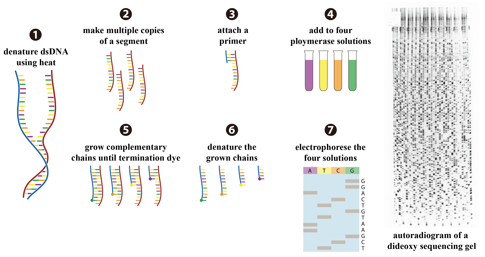

*Figure 1. Classical Sanger sequencing: ddNTP-mediated chain termination and electrophoretic separation. Reading fragments from shortest to longest gives the newly synthesized strand in the 5′→3′ direction.*

### Capillary Electrophoresis and Base Calling

Capillary electrophoresis is a separation and detection implementation of Sanger sequencing, not an independent base-recognition chemistry. A fused-silica capillary contains a replaceable polymer matrix that separates denatured extension products according to length. [[10]](#ref-10)

1. **Injection.** An electric field introduces negatively charged DNA fragments into the capillary.
2. **Separation.** Fragments migrate through the sieving matrix; shorter fragments generally reach the detector before longer fragments.
3. **Fluorescence detection.** A laser excites the labels as fragments pass a detection window. Spectral separation and instrument calibration distinguish dye signals.
4. **Base calling.** Software interprets the fluorescence traces as a chromatogram and assigns base calls and quality estimates. Peak overlap, background, mobility differences, and declining resolution at the read ends affect interpretation.

Chromatogram displays commonly use green, blue, black, and red for A, C, G, and T, respectively. These are software display conventions, not literal dye-emission colors. High-quality reads commonly span several hundred nucleotides and may approach approximately 1 kb under favorable conditions; usable length depends on template quality, chemistry, separation, and quality trimming. Mixed templates can produce superimposed peaks, and a heterozygous insertion or deletion can disrupt the trace downstream of the variant.

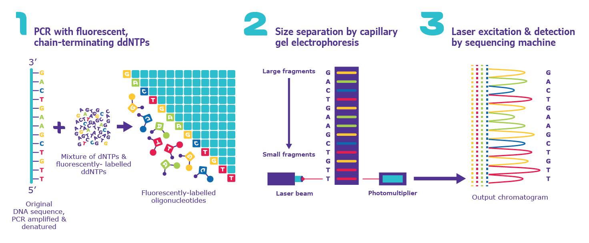

*Figure 2. Fluorescent chain termination, capillary separation, and chromatogram detection. The reaction uses single-primer cycle sequencing.*

### Chemical Cleavage Sequencing (Maxam–Gilbert)

Maxam–Gilbert sequencing determines sequence by partial chemical cleavage of end-labeled DNA. It does not require polymerase-mediated primer extension. The original method and later protocols used related reaction schemes; the following description uses the commonly taught **G, A+G, C, and C+T** scheme. [[6]](#ref-6)

1. **End labeling.** A strand is labeled at a defined end, conventionally using a radioactive 5′ phosphate. Restriction cleavage and purification, or strand separation, yield a fragment with a single labeled reference end on the strand to be read.
2. **Partial base-selective treatment.** DNA is divided among four reactions. Dimethyl sulfate preferentially modifies guanine; formic acid promotes purine loss in the A+G reaction; hydrazine modifies pyrimidines; and hydrazine with high salt preferentially targets cytosine. Limited reaction conditions generate overlapping populations of singly cleaved molecules rather than exhaustive digestion.
3. **Backbone cleavage.** Piperidine treatment promotes cleavage at susceptible modified or abasic sites, generating labeled fragments of different lengths.
4. **Separation and detection.** Denaturing electrophoresis resolves the fragments, which are detected by autoradiography or phosphor imaging.
5. **Sequence interpretation.** Bands in both G and A+G lanes indicate G; an A+G band without a corresponding G band indicates A. Bands in both C and C+T indicate C; a C+T band without a C band indicates T. Reading from the shortest fragments upward reports successive readable positions of the labeled strand; with a 5′ label, the direction is 5′→3′.

The method is historically important but has limited routine use because of hazardous reagents, cumbersome labeling and handling, and poor scalability relative to automated enzymatic sequencing.

## Massively Parallel Sequencing of Clonally Amplified Templates

Clonal amplification concentrates copies of an individual library molecule at one spatial location, such as a surface cluster, bead, or DNA nanoball. The aggregate signal is interpreted as one template sequence. **PCR-free library preparation does not necessarily eliminate clonal amplification during sequencing.** The amplification mechanism and the base-recognition chemistry should therefore be described separately.

### Reversible-Terminator SBS (Solexa/Illumina)

Illumina SBS identifies nucleotides during controlled extension of clonally amplified DNA templates. Reversible termination restricts extension to one nucleotide per active strand per cycle, and optical imaging identifies the incorporated base. [[15]](#ref-15)

1. **Library construction.** DNA is fragmented or otherwise prepared at an application-dependent insert length and supplied with sequencing adapters. Tagmentation combines fragmentation with introduction of adapter sequences; subsequent steps may complete adapter structures and add sample indexes. Library PCR is optional in PCR-free protocols. Conventional RNA-seq on these instruments sequences cDNA derived from RNA.
2. **Cluster generation.** Library molecules bind to complementary surface oligonucleotides. Traditional non-patterned flow cells use bridge amplification; many patterned flow cells use exclusion amplification (ExAmp), which couples template seeding and amplification in defined nanowells. Lane number, flow-cell geometry, and loading configuration are instrument dependent.
3. **Cyclic incorporation and imaging.** Polymerase extends the sequencing primer using reversible terminators. After incorporation, reagent exchange and imaging permit base identification. Label removal and deblocking restore an extendable end for the next cycle. Four-, two-, and one-channel implementations encode the four bases differently; four distinct dyes are not a universal requirement.
4. **Read and index acquisition.** Depending on the run configuration, the instrument acquires Read 1, index reads, and Read 2. Index reads identify pooled samples. Paired-end reads interrogate opposite ends of the same insert; PE150 generates two reads of up to 150 nt, not necessarily one contiguous 300-nt sequence.

A cluster provides the signal required by this optical architecture; this does not imply that single fluorophores cannot be detected by other optical systems. Loss of synchronization among strands produces **phasing and prephasing**, which contribute to declining quality over sequencing cycles. Other concerns include sequence-context effects, library amplification bias, low sequence diversity, optical overlap, and index misassignment.

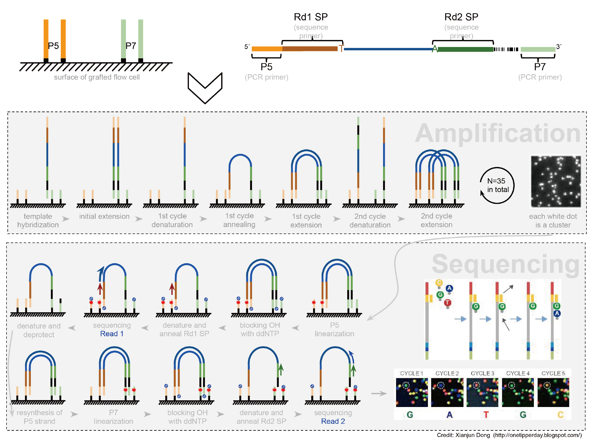

*Figure 3. Illumina bridge amplification, strand preparation, and paired-end reversible-terminator SBS.*

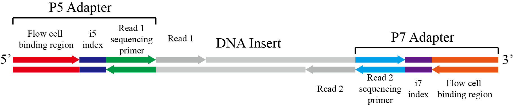

*Figure 4. Illumina paired-end library structure, showing flow-cell binding regions, i5/i7 indexes, and Read 1/Read 2 primer sites.*

### DNA Nanoball Sequencing (DNBSEQ, MGI)

DNBSEQ combines circular library templates, rolling-circle replication, patterned-array loading, and combinatorial probe-anchor synthesis (**cPAS**). The historical Complete Genomics implementation used combinatorial probe-anchor **ligation** (**cPAL**); DNA nanoballs do not, by themselves, specify whether sequencing uses synthesis or ligation. [[18]](#ref-18)

1. **Circularization.** An adapter-bearing single-stranded library molecule is circularized, commonly using a splint oligonucleotide and ligase. Residual linear molecules are removed according to the library protocol.
2. **DNB generation.** A strand-displacing polymerase repeatedly copies the original circular template, producing a concatemer that compacts into a DNA nanoball. Re-copying the original circle limits propagation of newly introduced copying errors compared with exponential amplification. Errors already present in the circular template, including earlier library-preparation errors, remain represented in its copies.
3. **Array loading.** DNBs bind to defined sites on a patterned array. Site geometry and surface chemistry favor single-DNB occupancy, but actual occupancy and usable read yield depend on loading conditions and quality filtering.
4. **cPAS cycles.** Primers anneal to adapter-associated sequences within the DNB. Polymerase-mediated incorporation of fluorescent nucleotide reagents, imaging, and chemical regeneration support cyclic base identification. cPAS is a synthesis-based method despite the word “probe” in its name.
5. **Paired-end acquisition.** Second-strand generation and strand-displacement steps provide a template for reading the opposite end. Detailed adapter and strand-processing configurations are kit dependent.

DNB generation does not remove library duplicates, guarantee absence of index misassignment, or make the workflow error-free. These outcomes also depend on library construction, indexing, loading, and analysis.

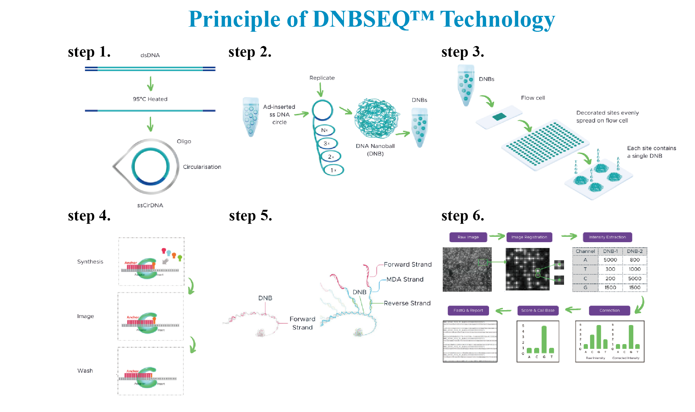

*Figure 5. DNBSEQ circularization, rolling-circle replication, array loading, cPAS, and base calling.*

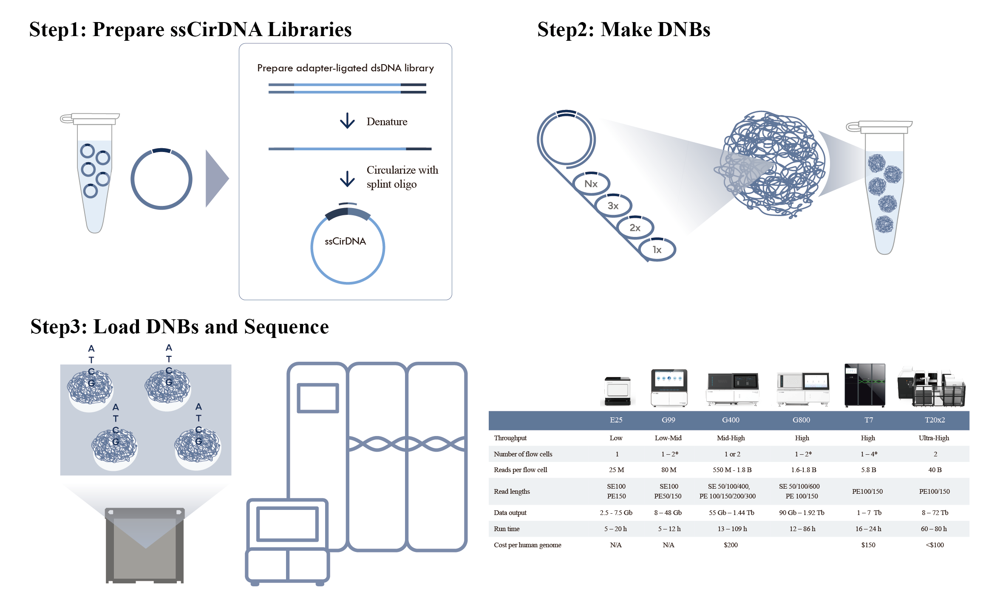

*Figure 6. Formation of single-stranded circular libraries and DNA nanoballs, with historical DNBSEQ instrument configurations.*

### Semiconductor SBS (Ion Torrent)

Ion Torrent measures local changes in hydrogen-ion concentration associated with nucleotide incorporation. The electrical signal is generated by a pH-sensitive semiconductor sensor, rather than by fluorescence or passage of DNA through a nanopore. [[19]](#ref-19)

1. Adapter-bearing library fragments are clonally amplified on beads, typically by emulsion PCR. Template-positive beads are enriched and loaded into sensor wells.
2. One nucleotide species is supplied per flow. If complementary to the template, it is incorporated by DNA polymerase; the resulting local pH change is detected beneath the well.
3. The nucleotide-flow order and measured electrical response are used to infer sequence. Remaining reagents are removed before subsequent flows.
4. A homopolymer can incorporate multiple identical nucleotides within one flow. Its length is inferred from signal magnitude; noise, incomplete extension, and imperfect proportionality limit resolution of longer runs.

The method uses unlabeled nucleotides and does not require optical imaging. Homopolymer-associated insertion/deletion errors, mixed-template wells, and reaction synchronization affect data quality.

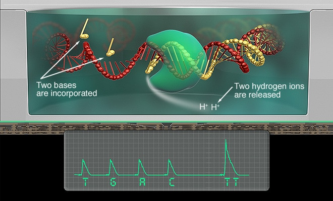

*Figure 7. Ion Torrent detects incorporation-associated hydrogen-ion release; signal amplitude reflects the number of nucleotides incorporated during a flow.*

### Pyrosequencing and the 454 Platform

Pyrosequencing measures pyrophosphate (PPi) released during DNA synthesis through a coupled light-producing reaction. In a conventional four-enzyme implementation, the primed template is combined with DNA polymerase, ATP sulfurylase, luciferase, and apyrase. [[11]](#ref-11)

1. A sequencing primer anneals to a prepared single-stranded template. In targeted assays, a biotinylated PCR product can be captured on streptavidin-coated beads and strand-separated.
2. One nucleotide species is added at a time. Each incorporation event releases PPi.
3. ATP sulfurylase uses PPi and adenosine 5′-phosphosulfate (APS) to generate ATP. Luciferase uses ATP in a light-producing reaction involving luciferin.
4. The measured light signal provides an estimate of how many nucleotides were incorporated during that flow. Apyrase degrades residual ATP and unincorporated nucleotides in the conventional four-enzyme workflow.
5. Deoxyadenosine 5′-(α-thio)triphosphate (dATPαS) substitutes for dATP to reduce direct luciferase activation by the adenine nucleotide reagent.

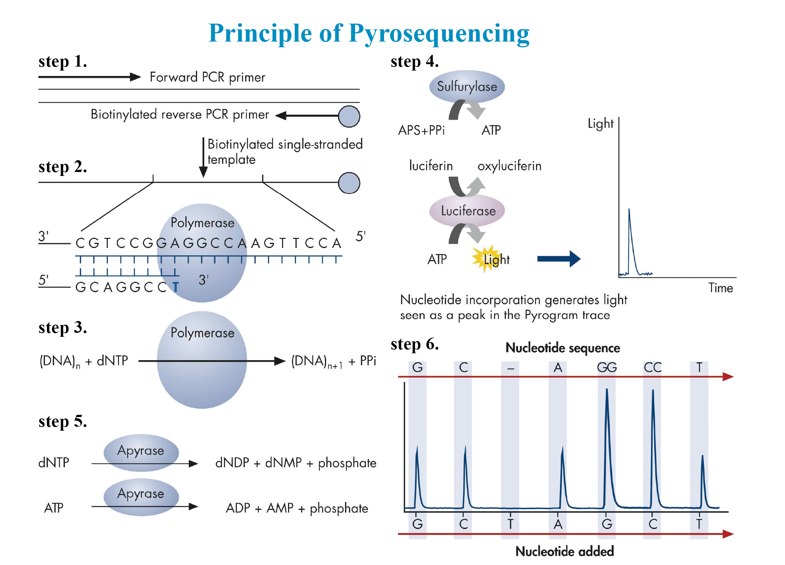

*Figure 8. Pyrosequencing couples PPi release to ATP synthesis and luciferase-mediated light production; apyrase removes residual substrates.*

The **454 platform** adapted this chemistry to massively parallel sequencing. Fragmented, adapter-ligated molecules underwent emulsion PCR on capture beads. Enriched beads were loaded into PicoTiterPlate wells with signal-generating enzymes. Sequential nucleotide flows, reagent removal, and CCD imaging produced a pyrogram for each template. Bead amplification was clonal; the subsequent measurement was not single-molecule detection. Wash and enzyme configurations varied among implementations. [[13]](#ref-13)

Signal intensity is approximately related to the number of incorporations within the calibrated range, not perfectly proportional for arbitrarily long homopolymers. This limitation produced characteristic homopolymer-associated indel errors. The legacy 454 platform and targeted pyrosequencing assays should not be treated as interchangeable workflows.

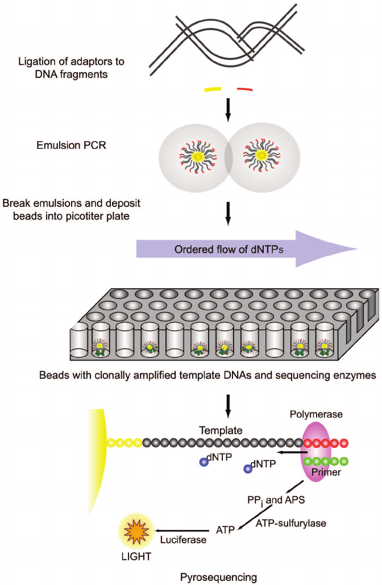

*Figure 9. The 454 workflow combines bead-based emulsion PCR, PicoTiterPlate loading, and parallel pyrosequencing.*

### Sequencing by Ligation (SOLiD)

SOLiD, originally developed by Applied Biosystems, uses ligase-mediated interrogation of clonally amplified templates. Fluorescent oligonucleotide probes hybridize adjacent to an annealed primer; correctly paired probes are ligated, imaged, and cleaved to prepare for another cycle. Extension products are subsequently removed, and interrogation restarts with offset primers. [[14]](#ref-14)

The classical two-base encoding scheme maps 16 dinucleotide combinations to four colors. Multiple primer offsets, typically five in the standard scheme, interrogate internal bases in overlapping dinucleotide contexts. This redundancy supports error discrimination, but does not mean that every individual color call is necessarily correct.

The primary representation is **color space**. Conversion to base space requires a known starting base; naive conversion can propagate an isolated color error into multiple incorrect nucleotide calls. SOLiD is an important historical example of sequencing by ligation and should be distinguished from polymerase-based SBS.

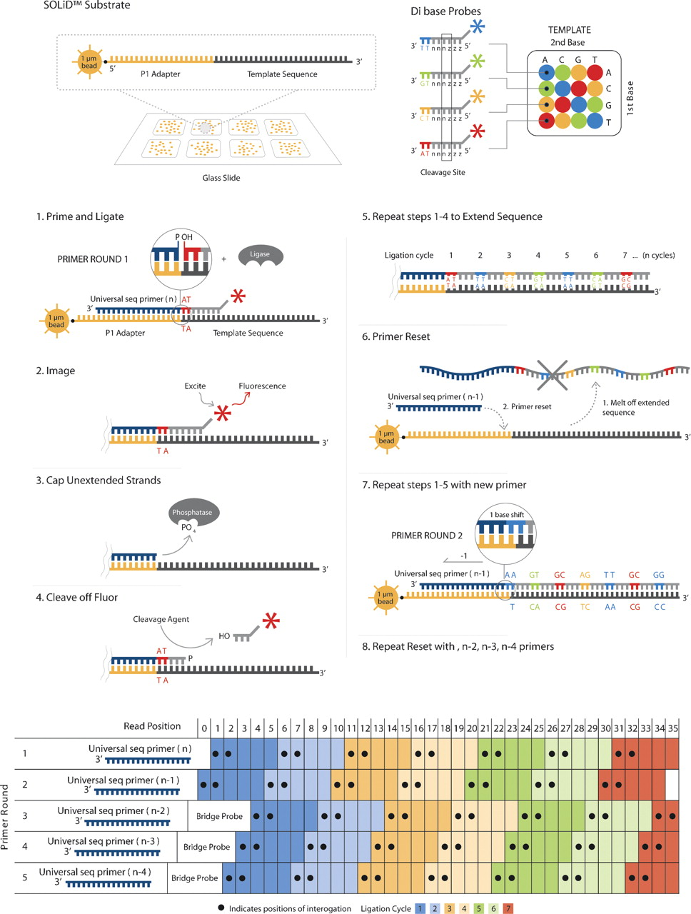

*Figure 10. SOLiD probe ligation, imaging, cleavage, and primer offsets provide overlapping two-base sequence information.*

### Sequencing by Binding (SBB, Onso)

SBB separates **base recognition** from **nucleotide incorporation**. During interrogation, a fluorescent nucleotide forms a base-selective complex with polymerase and the template–primer substrate without incorporation. After imaging, the interrogation reagents are removed. The primer end is deblocked, and an unlabeled, reversibly blocked nucleotide is incorporated to advance the strand by one base. The next interrogation cycle then begins. [[25]](#ref-25)

Thus, the detected fluorescent nucleotide is not the nucleotide covalently retained in the growing strand. Separation of recognition and extension permits different reaction conditions for these steps. Onso uses clonally amplified templates for short-read sequencing. In a targeted amplicon study, SBB reduced sequencing errors relative to uncorrected SBS and supported low-frequency variant detection. [[25]](#ref-25)

### Avidity Sequencing (Element AVITI)

Avidity sequencing uses multivalent fluorescent **avidites** to recognize bases without incorporating the detection reagent. Multiple nucleotide moieties bind matching polymerase–template complexes on nearby copies of the same sequence, stabilizing the optical signal. Avidite removal and a separate extension reaction advance the cycle. [[23]](#ref-23)

The published implementation captured circularized templates on the flow cell and generated polonies by local rolling-circle amplification. This arrangement differs from loading DNBs prepared in solution. Library handling and reaction details should be associated with the specified implementation rather than inferred from the shared use of circular templates.

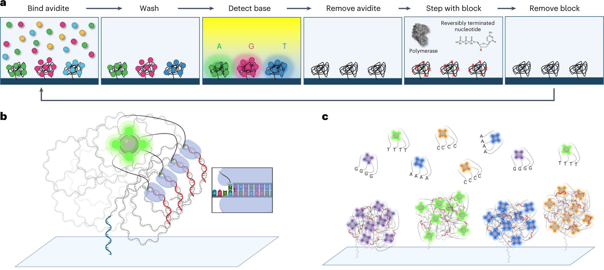

*Figure 11. Avidity sequencing: the reaction cycle (a), multivalent binding within a polony (b), and base-selective avidite recognition (c).*

### Flow-Based Mostly Natural SBS (Ultima)

Ultima's sequencing architecture combines clonally amplified templates on an open wafer with sequential nucleotide flows and a mixture of labeled and unlabeled nucleotides. Its mostly natural SBS approach allows extension through matching runs during a flow rather than enforcing the same one-base-per-cycle scheme used by reversible-terminator SBS. Flow signals, imaging, and computational models jointly determine the sequence. [[26]](#ref-26)

The open wafer provides a large reaction surface for parallel sequencing. Flow-signal estimation, homopolymer resolution, and synchronization among template copies are principal limitations.

## Single-Molecule Sequencing

### Single-Molecule Real-Time Sequencing (PacBio)

SMRT sequencing observes DNA synthesis by an individual polymerase immobilized in a **zero-mode waveguide (ZMW)**. The confined observation volume limits fluorescence from freely diffusing reagents while permitting detection near the polymerase. Fluorophores attached to terminal phosphate groups generate distinguishable pulses during nucleotide interaction and incorporation; labeled phosphate products subsequently leave the active site. Continuous synthesis therefore does not require a separate imaging-and-deblocking cycle after each nucleotide. [[16]](#ref-16)

A **SMRTbell** template consists of a double-stranded DNA insert joined at both ends by hairpin adapters. The polymerase can traverse one insert strand, an adapter, the complementary strand, and the other adapter repeatedly. Template integrity, insert size, polymerase processivity, and acquisition duration influence the number of usable observations.

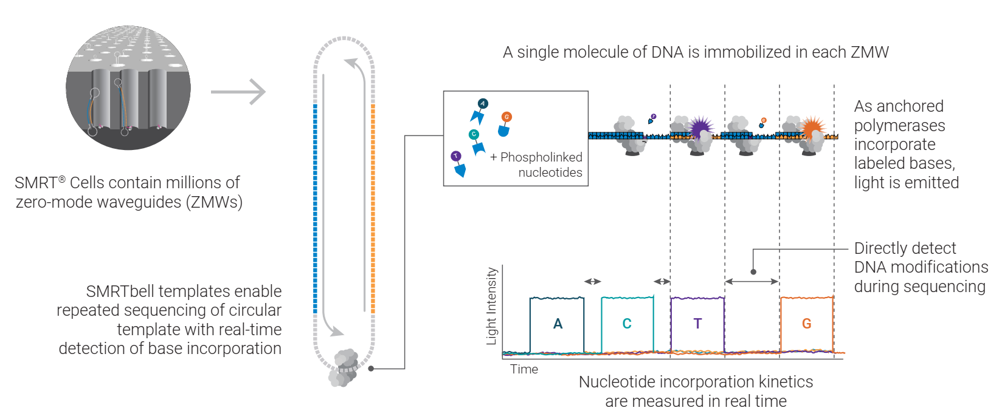

*Figure 12. SMRTbell traversal in a ZMW generates fluorescence pulses and polymerase-kinetic information.*

#### Polymerase Reads, Subreads, CLR, CCS, and HiFi

| Term | Definition and interpretation |
| --- | --- |
| **Polymerase read** | The continuous sequence observed from one polymerase; it can include adapters and multiple traversals of the insert. |
| **Subread** | An insert observation between identified adapter regions, or a partial observation at a read boundary. It represents one traversal of one insert strand, not necessarily an independent biological molecule. |
| **Continuous long read (CLR)** | A historical sequencing mode emphasizing long individual observations with comparatively high single-pass error. CLR data can contain multiple subreads; the mode does not require exactly one template traversal. |
| **Circular consensus sequence (CCS)** | A per-molecule consensus inferred from repeated observations of the same SMRTbell template. This differs from a consensus across independently sampled molecules. |
| **HiFi read** | A high-accuracy CCS read produced by repeated template observations, consensus inference, and quality filtering. |

Additional passes improve per-molecule consensus accuracy, subject to correlated errors and model limitations. They increase confidence in the insert sequence without increasing its physical length. [[20]](#ref-20)

HiFi library insert lengths are selected to balance sequence span against sufficient repeated observations. Long-read whole-genome workflows commonly target inserts on the order of tens of kilobases, whereas targeted, microbial, and transcript applications can use other sizes. Wenger and colleagues demonstrated how accurate long reads support small-variant detection, structural-variant analysis, and assembly. [[20]](#ref-20)

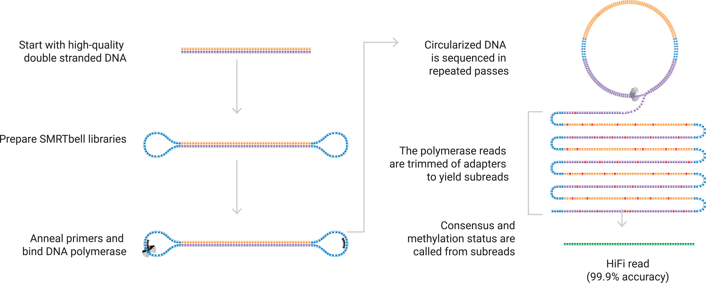

*Figure 13. Repeated SMRTbell observations are processed into subreads and a per-molecule HiFi consensus.*

#### Modification Signals and Limitations

Polymerase kinetics, including interpulse duration and pulse width, can contain information about base modifications. Modification calling depends on the modification type, model, sequence context, chemistry, and evidence available; a fluorescence base call alone is not a modification call. Native-DNA workflows preserve modification information that PCR or cDNA synthesis generally does not preserve in its original molecular form. [[27]](#ref-27)

SMRT sequencing does not require clonal template amplification for detection, although specific library workflows may include PCR. DNA damage, low library recovery, insufficient passes, residual context-dependent errors, and short molecules can affect usable yield and application performance.

### Direct Nanopore Sequencing (Oxford Nanopore Technologies)

Nanopore sequencing measures a time-dependent ionic current while a nucleic acid strand passes through a protein pore under an applied potential. A motor protein regulates strand motion. The local sequence context within the pore's sensing region modulates the current, and a computational basecaller infers the sequence from the resulting signal. A current level is not a universal one-to-one label for an isolated A, C, G, or T. [[28]](#ref-28)

1. **Library preparation.** Suitable adapters and motor-associated components are attached to prepared DNA or RNA. Native-DNA workflows can avoid PCR; amplified DNA and cDNA workflows are also possible.
2. **Capture and translocation.** A molecule is captured at an active pore. For double-stranded DNA, strand separation permits controlled passage of a single strand.
3. **Electrical measurement.** Electrodes and an application-specific integrated circuit (ASIC) record changes in ionic current. Basecalling models depend on pore chemistry, motor behavior, and the acquired signal.
4. **Sequence and modification inference.** Models infer canonical bases and, where supported, modifications from signal patterns. Read filtering and downstream alignment or assembly address residual uncertainty.

**Simplex** reads describe single-strand observations. **Duplex** processing combines observations of complementary strands from the same DNA molecule when both are successfully acquired. A consensus derived from many molecules or a genome assembly is another level of evidence and must not be reported as raw simplex accuracy.

**Direct RNA sequencing** measures the RNA strand itself, unlike cDNA sequencing. Some direct-RNA library protocols include complementary-DNA synthesis to support the workflow, but the strand passing through the pore is RNA. [[29]](#ref-29)

Read lengths depend strongly on molecule integrity, extraction, and library preparation; very long DNA reads are not guaranteed for every sample. Signal ambiguity, homopolymers, translocation irregularities, and basecaller version contribute to error patterns.

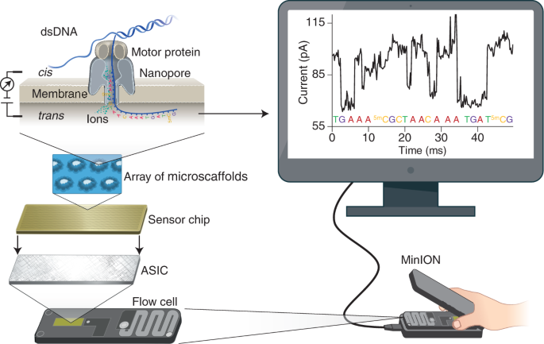

*Figure 14. Motor-controlled nucleic acid translocation through a nanopore modulates ionic current for sequence inference.*

### Sequencing by Expansion (SBX, Roche)

SBX uses a biochemical conversion step to encode a template sequence into an **Xpandomer**, a synthetic surrogate polymer carrying expanded reporter structures. A nanopore sensor detects the reporter pattern, which is decoded back into the biological sequence. The measured molecule is therefore different from the native DNA or RNA strand interrogated in direct nanopore sequencing. [[24]](#ref-24)

Expansion increases reporter spacing and signal distinguishability; it does not multiply the number of biological bases represented by the original insert. Biochemical conversion fidelity, reporter detection, and decoding all contribute to the error budget. Native modification detection cannot be assumed solely from the use of a nanopore sensor; preservation or encoding of modification information requires an appropriate assay.

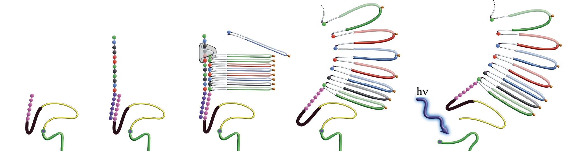

*Figure 15. SBX template-directed synthesis and expansion of an Xpandomer; hν denotes the photochemical step.*

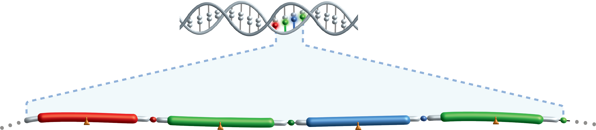

*Figure 16. SBX maps the template sequence onto spatially separated reporter units for nanopore detection.*

## Advantages and Limitations of Sequencing Technologies

| Technology | Principal mechanism | Advantages | Limitations |
| --- | --- | --- | --- |
| Sanger / capillary electrophoresis | ddNTP chain termination and length-based separation | Accurate sequence inspection for individual targets; directly interpretable chromatograms | Low throughput; mixed templates produce overlapping peaks; limited sensitivity to low-frequency alleles |
| Maxam–Gilbert | Base-selective cleavage of end-labeled DNA | Determines sequence without polymerase-mediated extension or a sequencing primer | Hazardous reagents, laborious handling, and poor scalability |
| Illumina | Reversible-terminator SBS on clonal clusters | High parallelism; controlled single-base extension; paired-end reads provide information from both insert ends | Short reads limit repeat resolution and phasing; phasing/prephasing, amplification bias, and index misassignment affect data |
| DNBSEQ | Rolling-circle template replication followed by cPAS | Dense patterned arrays; repeated copying of the original circle limits propagation of new amplification errors | Short-read ambiguity remains; template and library-preparation errors persist; usable yield depends on DNB loading |
| Ion Torrent | Electrical detection of incorporation-associated pH changes | Unlabeled nucleotides; no fluorescence excitation or optical imaging | Homopolymer length estimation from signal amplitude; mixed-template wells and incomplete extension |
| Pyrosequencing / 454 | PPi release coupled to light production | Real-time incorporation detection; quantitative signals support targeted sequence analysis; 454 enabled parallelization | Homopolymer-associated indels; coupled enzyme reactions and reagent carryover complicate signal interpretation |
| SOLiD | Probe ligation with overlapping two-base encoding | Redundant dinucleotide interrogation supports error discrimination | Short reads, multi-stage ligation cycles, and complex color-space interpretation |
| SBB / Onso | Separate nucleotide recognition and extension | Independent optimization of recognition and incorporation; fluorescent interrogation reagents are not retained in the strand | Short-read span; binding, extension, synchronization, and library errors remain possible |
| Avidity / AVITI | Multivalent avidite recognition followed by separate extension | Stable multivalent binding supports strong optical signals and low detection-reagent consumption | Requires clonal polonies; limited molecular span and residual synchronization or sequence-context effects |
| Ultima mostly natural SBS | Sequential nucleotide flows over amplified templates on an open wafer | Large reaction surface; extension without a reversible-termination step at every base | Homopolymer and flow-signal estimation; synchronization errors; platform-specific data processing |
| PacBio SMRT / HiFi | Single-polymerase fluorescence and circular consensus | Accurate long reads for repeats, haplotypes, and structural variants; kinetic information supports modification analysis | Insert length must allow sufficient passes; DNA damage and low library recovery reduce usable yield |
| Oxford Nanopore | Ionic-current sensing of native nucleic acid strands | Long and ultra-long reads; direct RNA sequencing; real-time acquisition and modification analysis | Read length depends on molecule integrity; context-dependent signal ambiguity and basecaller-dependent errors |
| SBX / AXELIOS 1 | Nanopore sensing of an expanded surrogate polymer | Expanded reporter spacing improves signal distinguishability and supports parallel electrical detection | Conversion and decoding introduce additional error sources; physical expansion does not increase biological read length |

## References

1. Watson, J. D., & Crick, F. H. C. (1953). Molecular structure of nucleic acids: A structure for deoxyribose nucleic acid. *Nature*, 171, 737–738. [DOI](https://doi.org/10.1038/171737a0)

2. Franklin, R. E., & Gosling, R. G. (1953). Molecular configuration in sodium thymonucleate. *Nature*, 171, 740–741. [DOI](https://doi.org/10.1038/171740a0)

3. Wilkins, M. H. F., Stokes, A. R., & Wilson, H. R. (1953). Molecular structure of deoxypentose nucleic acids. *Nature*, 171, 738–740. [DOI](https://doi.org/10.1038/171738a0)

4. Holley, R. W., et al. (1965). Structure of a ribonucleic acid. *Science*, 147, 1462–1465. [DOI](https://doi.org/10.1126/science.147.3664.1462)

5. Sanger, F., & Coulson, A. R. (1975). A rapid method for determining sequences in DNA by primed synthesis with DNA polymerase. *Journal of Molecular Biology*, 94, 441–448. [DOI](https://doi.org/10.1016/0022-2836(75)90213-2)

6. Maxam, A. M., & Gilbert, W. (1977). A new method for sequencing DNA. *Proceedings of the National Academy of Sciences USA*, 74, 560–564. [DOI](https://doi.org/10.1073/pnas.74.2.560)

7. Sanger, F., Nicklen, S., & Coulson, A. R. (1977). DNA sequencing with chain-terminating inhibitors. *Proceedings of the National Academy of Sciences USA*, 74, 5463–5467. [DOI](https://doi.org/10.1073/pnas.74.12.5463)

8. Smith, L. M., et al. (1986). Fluorescence detection in automated DNA sequence analysis. *Nature*, 321, 674–679. [DOI](https://doi.org/10.1038/321674a0)

9. Prober, J. M., et al. (1987). A system for rapid DNA sequencing with fluorescent chain-terminating dideoxynucleotides. *Science*, 238, 336–341. [DOI](https://doi.org/10.1126/science.2443975)

10. Swerdlow, H., & Gesteland, R. (1990). Capillary gel electrophoresis for rapid, high resolution DNA sequencing. *Nucleic Acids Research*, 18, 1415–1419. [DOI](https://doi.org/10.1093/nar/18.6.1415)

11. Ronaghi, M., Karamohamed, S., Pettersson, B., Uhlén, M., & Nyrén, P. (1996). Real-time DNA sequencing using detection of pyrophosphate release. *Analytical Biochemistry*, 242, 84–89. [DOI](https://doi.org/10.1006/abio.1996.0432)

12. International Human Genome Sequencing Consortium. (2004). Finishing the euchromatic sequence of the human genome. *Nature*, 431, 931–945. [DOI](https://doi.org/10.1038/nature03001)

13. Margulies, M., et al. (2005). Genome sequencing in microfabricated high-density picolitre reactors. *Nature*, 437, 376–380. [DOI](https://doi.org/10.1038/nature03959)

14. Valouev, A., et al. (2008). A high-resolution, nucleosome position map of C. elegans reveals a lack of universal sequence-dictated positioning. *Genome Research*, 18, 1051–1063. [DOI](https://doi.org/10.1101/gr.076463.108)

15. Bentley, D. R., et al. (2008). Accurate whole human genome sequencing using reversible terminator chemistry. *Nature*, 456, 53–59. [DOI](https://doi.org/10.1038/nature07517)

16. Eid, J., et al. (2009). Real-time DNA sequencing from single polymerase molecules. *Science*, 323, 133–138. [DOI](https://doi.org/10.1126/science.1162986)

17. Pushkarev, D., Neff, N. F., & Quake, S. R. (2009). Single-molecule sequencing of an individual human genome. *Nature Biotechnology*, 27, 847–850. [DOI](https://doi.org/10.1038/nbt.1561)

18. Drmanac, R., et al. (2010). Human genome sequencing using unchained base reads on self-assembling DNA nanoarrays. *Science*, 327, 78–81. [DOI](https://doi.org/10.1126/science.1181498)

19. Rothberg, J. M., et al. (2011). An integrated semiconductor device enabling non-optical genome sequencing. *Nature*, 475, 348–352. [DOI](https://doi.org/10.1038/nature10242)

20. Wenger, A. M., et al. (2019). Accurate circular consensus long-read sequencing improves variant detection and assembly of a human genome. *Nature Biotechnology*, 37, 1155–1162. [DOI](https://doi.org/10.1038/s41587-019-0217-9)

21. Nurk, S., et al. (2022). The complete sequence of a human genome. *Science*, 376, 44–53. [DOI](https://doi.org/10.1126/science.abj6987)

22. Liao, W.-W., et al. (2023). A draft human pangenome reference. *Nature*, 617, 312–324. [DOI](https://doi.org/10.1038/s41586-023-05896-x)

23. Arslan, S., et al. (2024). Sequencing by avidity enables high accuracy with low reagent consumption. *Nature Biotechnology*, 42, 132–138. [DOI](https://doi.org/10.1038/s41587-023-01750-7)

24. Kokoris, M., et al. (2025). Sequencing by Expansion (SBX)—a novel, high-throughput single-molecule sequencing technology. *bioRxiv*, 2025.02.19.639056. Preprint. [DOI](https://doi.org/10.1101/2025.02.19.639056)

25. Allender, C. J., et al. (2024). Sequencing by binding rivals SMOR error-corrected sequencing by synthesis technology for accurate detection and quantification of minor (<0.1%) subpopulation variants. *BMC Genomics*, 25, 789. [DOI](https://doi.org/10.1186/s12864-024-10697-1)

26. Simmons, S. K., et al. (2023). Mostly natural sequencing-by-synthesis for scRNA-seq using Ultima sequencing. *Nature Biotechnology*, 41, 204–211. [DOI](https://doi.org/10.1038/s41587-022-01452-6)

27. Flusberg, B. A., et al. (2010). Direct detection of DNA methylation during single-molecule, real-time sequencing. *Nature Methods*, 7, 461–465. [DOI](https://doi.org/10.1038/nmeth.1459)

28. Jain, M., et al. (2018). Nanopore sequencing and assembly of a human genome with ultra-long reads. *Nature Biotechnology*, 36, 338–345. [DOI](https://doi.org/10.1038/nbt.4060)

29. Garalde, D. R., et al. (2018). Highly parallel direct RNA sequencing on an array of nanopores. *Nature Methods*, 15, 201–206. [DOI](https://doi.org/10.1038/nmeth.4577)
