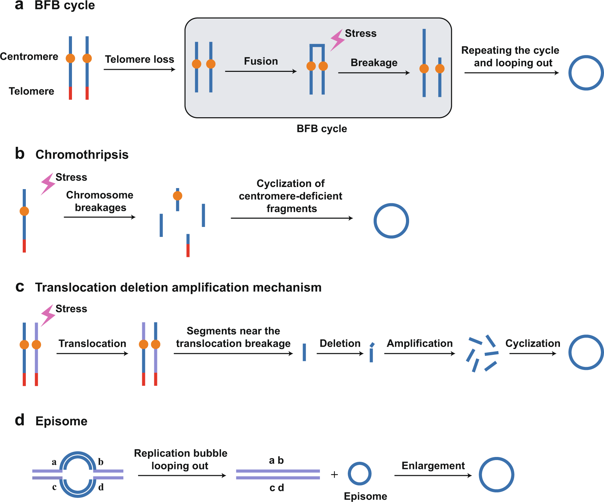
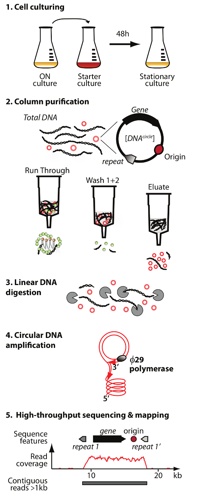

# Introduction

Extrachromosomal circular DNA (eccDNA), ranging in size from tens to millions of base pairs, is independent of conventional chromosomes.

## Models of eccDNA formation mechanism



1. **Breakage-fusion-bridge (BFB) cycle:** A dicentric anaphase bridge forms in the absence of telomeres. The BFB cycle involves an anaphase bridge, followed by bridge breakage under stress, releasing eccDNA.
2. **Chromothripsis:** Single- or double-stranded DNA breaks are formed under exogenous stress, and some of the fragments are ligated and circularized into eccDNA.
3. **Translocation-deletion amplification:** Exogenous stimuli trigger chromosomal translocation. The DNA segments near the translocation breakpoints are amplified, deleted, and circularized to form ecDNA.
4. **Episome:** Episomes are produced by DNA slippage and R-loops during the DNA synthesis process and are able to self-replicate and enlarge to form multimerized eccDNA.

## Molecular structures of eccDNA

1. eccDNAs are circular and independently replicate outside of chromosomes.
2. eccDNAs vary widely in size, from a few dozen base pairs to hundreds of thousands of base pairs.
3. eccDNAs have different genetic contents, which constitute the structural diversity of eccDNAs.
4. compared to chrDNAs, eccDNAs mainly contain active histone marks with a more accessible chromatin landscape.
5. eccDNAs appear to possess unusual structural plasticity.

## Regulatory mechanisms of functional eccDNA

1. EccDNA contributes to gene amplification and signaling pathway regulation
2. EccDNA participates in restoring telomere length
3. EccDNA involves in genome plasticity and adaptive evolution
4. EccDNA serves as a molecular sponge

---

## Library Strategy

### WGS

Extrachromosomal circular DNA (eccDNA) can be reconstructed from whole‑genome sequencing (WGS) data. In tumor genomes, highly amplified and structurally rearranged loci often produce discordant paired‑end alignments and split‑read signatures that are characteristic of circular DNA elements. By leveraging specialized computational pipelines, these signals can be integrated to infer and resolve the sequence architecture of eccDNAs. However, conventional WGS‑based algorithms typically lack sensitivity for low‑abundance eccDNAs, causing many rare circular molecules to be overlooked.

### Circle-seq

Circle-seq is a purification and detection method, was developed to screen for a novel or low-abundant eccDNA in the genomic range.

MssI restriction enzyme: GTTT^AAAC
ATP-dependent exonuclease:
Rolling Circle Amplification (RCA): ø29 DNA polymerase



- H.D. Møller,L. Parsons,T.S. Jørgensen,D. Botstein,& B. Regenberg,  Extrachromosomal circular DNA is common in yeast, Proc. Natl. Acad. Sci. U.S.A. 112 (24) E3114-E3122, (2015). https://doi.org/10.1073/pnas.1508825112
- Møller, H. D., Bojsen, R. K., Tachibana, C., Parsons, L., Botstein, D., Regenberg, B. Genome-wide Purification of Extrachromosomal Circular DNA from Eukaryotic Cells. J. Vis. Exp. (110), e54239, doi:10.3791/54239 (2016).
- Møller, H.D., Mohiyuddin, M., Prada-Luengo, I. et al. Circular DNA elements of chromosomal origin are common in healthy human somatic tissue. Nat Commun 9, 1069 (2018). https://doi.org/10.1038/s41467-018-03369-8

### CIDER-seq (TGS)

CIDER-Seq is another novel circular DNA detection method based on randomly primed circular DNA amplification, followed by long-read single-molecule sequencing.

- Mehta, D., Cornet, L., Hirsch-Hoffmann, M. et al. Full-length sequencing of circular DNA viruses and extrachromosomal circular DNA using CIDER-Seq. Nat Protoc 15, 1673–1689 (2020). https://doi.org/10.1038/s41596-020-0301-0

### ATAC-seq

- Pankaj Kumar et al. ,ATAC-seq identifies thousands of extrachromosomal circular DNA in cancer and cell lines.Sci. Adv.6,eaba2489(2020).DOI:10.1126/sciadv.aba2489

### Other Epigenetic Techniques

## Database

1. [CircleBase](http://circlebase.beyondthe.top:580)
2. [eccDNAdb](https://www.zhounan.org/eccdnadb/current)

---

# Data Preprocessing

## Alignment

### 1). [BWA](https://github.com/lh3/bwa)

```shell
bwa mem -t {threads} {input.index} {input.fq1} {input.fq2} | \
    samtools view -@ {threads} -b -o {output.bam}
# -q: don't modify mapQ of supplementary alignments. (Circle-Map)
# -M: mark shorter split hits as secondary
```

### 2). [Bowtie2](https://github.com/BenLangmead/bowtie2)

```shell
bowtie2 -p {threads} --local --very-sensitive -x {input.index} \
    --maxins 1000 -1 {input.fq1} -2 {input.fq2} | \
    samtools view -@ {threads} -b -o {output.bam}
```

```shell
# cs.bam: Coordinate-sorted bam
# ns.bam: Name-sorted bam
```

## Identify eccDNA (WGS)

### [AmpliconSuite-pipeline](https://github.com/AmpliconSuite/AmpliconSuite-pipeline)

A multithread-enabled end-to-end wrapper for **AmpliconArchitect** and **AmpliconClassifier** to enable analysis of focal copy number amplifications such as ecDNA or BFBs from paired-end whole genome sequencing data.

> - [PrepareAA](https://github.com/hoonbiolab/PrepareAA): A multithread-enabled quickstart tool for AmpliconArchitect. Performs all preliminary steps (alignment, CNV calling, seed interval detection) required prior to running AmpliconArchitect.
> - [AmpliconArchitect (AA)](https://github.com/virajbdeshpande/AmpliconArchitect): AmpliconArchitect (AA) is a tool designed to study focal amplifications in the cancer genome. AA can help identify common sources of focal amplifications, such as circular extrachromosomal DNA (ecDNA), and breakage-fusion-bridge cycles (BFBs).
> - Deshpande, V., Luebeck, J., Nguyen, NP.D. et al. Exploring the landscape of focal amplifications in cancer using AmpliconArchitect. Nat Commun 10, 392 (2019). https://doi.org/10.1038/s41467-018-08200-y

```shell
# Starting from .fastq files, using CNVkit for seed generation.
AmpliconSuite-pipeline.py -t {threads} --ref {GRCh38} --run_AA --run_AC  \
    --cnvkit_dir {cnvkit.py} --cngain 4.5 --cnsize_min 50000 \
    --fastqs {input.fq1} {input.fq2} -s {prefix} -o {output.dir}

# Starting from .bam, using CNVkit for seed generation.
AmpliconSuite-pipeline.py -t {threads} --ref {GRCh38} --run_AA --run_AC \
    --cnvkit_dir {cnvkit.py} --cngain 4.5 --cnsize_min 50000 \
    --bam {input.cs.bam} -s {prefix} -o {output.dir}

# Starting from .bam and your own whole-genome CNV calls, or an existing AA_CNV_SEEDS.bed
?AmpliconSuite-pipeline.py -t {threads} --ref {GRCh38} --run_AA \
    --cnvkit_dir {cnvkit.py} --cngain 4.5 --cnsize_min 50000 \
    --bam {input.cs.bam} --cnv_bed {input.bed} -s {prefix} -o {output.dir}

# Note the analysis environment and refer to the documentation.
```

### [AmpliconReconstructor (AR)](https://github.com/AmpliconSuite/AmpliconReconstructorOM)

- Luebeck, J., Coruh, C., Dehkordi, S.R. et al. AmpliconReconstructor integrates NGS and optical mapping to resolve the complex structures of focal amplifications. Nat Commun 11, 4374 (2020). https://doi.org/10.1038/s41467-020-18099-z

## Identify eccDNA (Circle-seq)

### [Circle-Map](https://github.com/iprada/Circle-Map)

Circle-Map takes as input an alignment of reads to a reference genome (e.g. a BWA-MEM generated BAM file) and like other methods, it will use those alignments to detect cases were the read has been split into two segments (e.g. split reads) to detect genomic rearrangements supporting a circular DNA structure.

```shell
conda create -n circlemap -c conda-forge -c bioconda circle-map samtools python=3.8
```

```shell
# Extract the reads that indicate circular DNA rearrangements.
Circle-Map ReadExtractor -i {input.ns.bam} -o {output.candidates.bam}

# Sort the read candidates by coordinate
samtools sort -@ {threads} -o {output.candidates.sorted.bam} {input.candidates.bam}
samtools index {input.cs.bam}
samtools index {input.candidates.sorted.bam}

# Detecting the circular DNA
Circle-Map Realign -t {threads} -i {input.candidates.sorted.bam} \
    -qbam {input.ns.bam} -sbam {input.cs.bam} \
    -fasta {input.genome.fa} -o {output.bed}

# Filter circular DNA (Split reads >= 1)
awk -v '$5 >= 1 {print $0}' ${input.bed} > ${output.bed}
```


## Identify eccDNA (ATAC-seq)

### [Circle_finder](https://github.com/pk7zuva/Circle_finder)

A method to identify Circular DNA (Micro DNA) from pair-end high-throughput sequencing data.

- Yoshiyuki Shibata et al. ,Extrachromosomal MicroDNAs and Chromosomal Microdeletions in Normal Tissues.Science336,82-86(2012).DOI:10.1126/science.1213307

## Others

```shell
# Extract Soft-clipped Reads
bamtools filter -cigarContaining S -in {input.bam} -out {output.softRead.bam}
sambamba view -h -t {threads} -F "clipped" -o {output.softRead.bam} {input.bam}
```

---

# Reference

1. J. Zachary Sanborn, Sofie R. Salama, et al. Double Minute Chromosomes in Glioblastoma Multiforme Are Revealed by Precise Reconstruction of Oncogenic Amplicons. Cancer Res 1 October 2013; 73 (19): 6036–6045. https://doi.org/10.1158/0008-5472.CAN-13-0186
2. H.D. Møller,L. Parsons,T.S. Jørgensen,D. Botstein, & B. Regenberg,  Extrachromosomal circular DNA is common in yeast, Proc. Natl. Acad. Sci. U.S.A. 112 (24) E3114-E3122, https://doi.org/10.1073/pnas.1508825112 (2015).
3. Møller, H. D., Bojsen, R. K., Tachibana, C., Parsons, L., Botstein, D., Regenberg, B. Genome-wide Purification of Extrachromosomal Circular DNA from Eukaryotic Cells. J. Vis. Exp. (110), e54239, doi:10.3791/54239 (2016).
4. Yang, L., Jia, R., Ge, T. et al. Extrachromosomal circular DNA: biogenesis, structure, functions and diseases. Sig Transduct Target Ther 7, 342 (2022). https://doi.org/10.1038/s41392-022-01176-8
5. Turner, K., Deshpande, V., Beyter, D. et al. Extrachromosomal oncogene amplification drives tumour evolution and genetic heterogeneity. Nature 543, 122–125 (2017). https://doi.org/10.1038/nature21356
6. Wu, S., Turner, K.M., Nguyen, N. et al. Circular ecDNA promotes accessible chromatin and high oncogene expression. Nature 575, 699–703 (2019). https://doi.org/10.1038/s41586-019-1763-5
7. Kim, H., Nguyen, NP., Turner, K. et al. Extrachromosomal DNA is associated with oncogene amplification and poor outcome across multiple cancers. Nat Genet 52, 891–897 (2020). https://doi.org/10.1038/s41588-020-0678-2