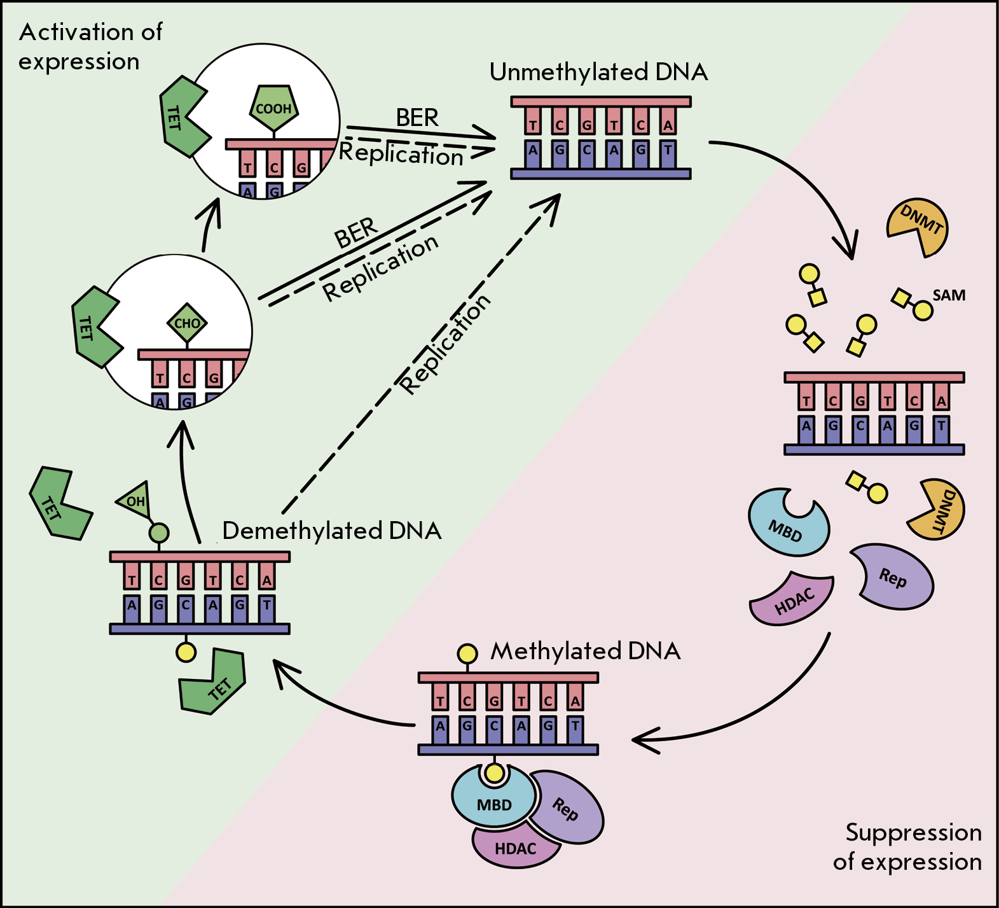
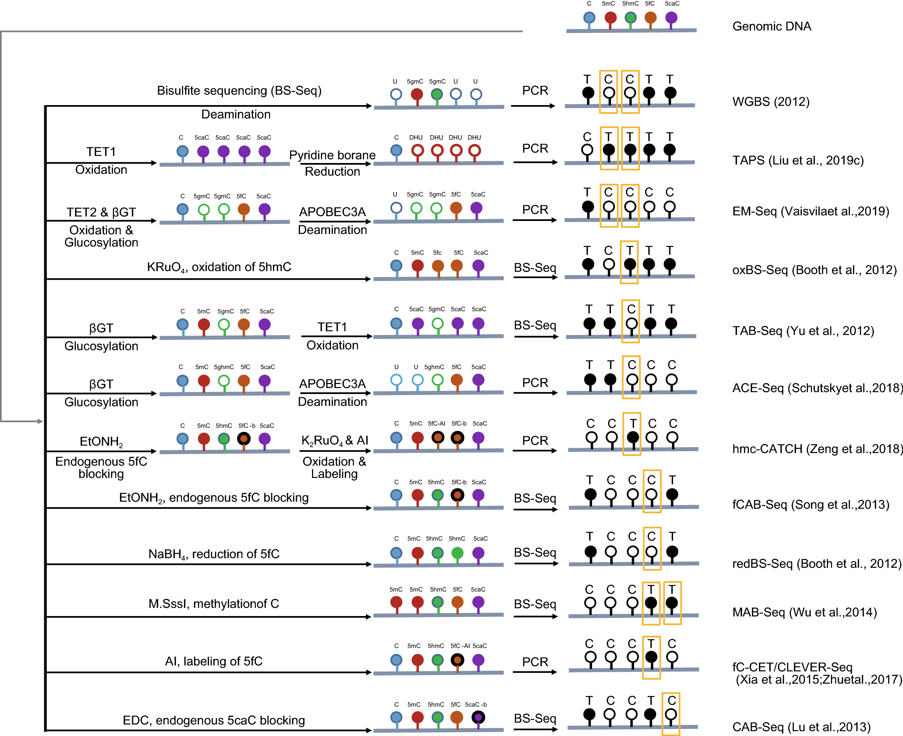

# Introduction

## 1. Definition

**DNA methylation** is a major epigenetic modification that regulates gene expression without altering the underlying DNA sequence. It is established by the covalent addition of a methyl group ($-CH_3$) to the 5-carbon position of cytosine, producing 5-methylcytosine (5mC). **In mammalian somatic cells, DNA methylation occurs predominantly at CpG dinucleotides and is catalyzed by DNA methyltransferases (DNMTs), which use S-adenosylmethionine (SAM) as the methyl donor.** DNA methylation plays essential roles in **transcriptional regulation, genomic imprinting, X-chromosome inactivation, transposable element silencing, and the maintenance of genome stability**. It generally represses gene transcription by reducing the accessibility of regulatory DNA elements, inhibiting transcription factor binding, and recruiting methyl-CpG-binding proteins that promote chromatin condensation.

### 5-Methylcytosine (5mC)

### 5-Hydroxymethylcytosine (5hmC)

### N(6)-methyladenine (6mA)

## 2. Regulation Mechanism

<figure style="text-align: center; margin: 1em 0;">
    
    <figcaption style="font-size: 1em; margin-top: 8px;">
        DNA methylation as an epigenetic mechanism of gene expression regulation
    </figcaption>
</figure>

> 1. DNA methyltransferase family proteins (DNMTs)
> 	- DNMT1: Maintenance methyltransferases, UHRF1
> 	- DNMT3A: De novo methyltransferases
> 	- DNMT3B: De novo methyltransferases
> 	- DNMT3C:
> 	- DNMT3L: inactive DNMT
> 2. Ten-eleven translocation family proteins (TETs)
> 	- TET1: DNA demethylation
> 	- TET2: DNA demethylation
> 	- TET3: DNA demethylation
> 3. DNA methylation reader
> 	- MBD proteins
> 4. Inhibitors of DNA methylation
> 	- 5-Azacytidine (5-氮杂胞苷): Azacitidine, 5-AzaC, Ladakamycin, 4-Amino-1-(β-D-ribofuranosyl)-1,3,5-triazin-2(1H)-one
> 	- 5-aza-2′-deoxycytidine (5-氮杂-2′-脱氧胞苷): 5-Aza-2′-Deoxycytidine, 5-Aza-CdR, 5-Aza-dC, 2′-Deoxy-5-azacytidine, Decitabine, 4-Amino-1-(2-deoxy-b-D-ribofuranosyl)-1,3,5-triazin-2(1H)-one
> 5. Total CpG CHH (where H correspond to A, T or C) CHG: 1,103,157,779
> 	- Among the 1.1 billion CH positions examined in the human genome
> 	- CHH: 827461778/2
> 	- CHG: 231960327/2
> 	- Number of CpG: The human genome contains ∼28 million CpG sites
> 	- CpG: 43735674/2
> 6. Restriction enzymes
> 	- MspI digestion can locate all CCGG sites in the genome
> 	- the complementary methylation-sensitive HpaII digestion can reveal the CpG methylation status
> 
> **CpG island:** Defined as regions 500 bp, 55% GC and expected/observed CpG ratio of 0.65. 40% of gene promoters contain islands.
> **CpG shores:** ~2Kb from islands, 75% of tissuespecifc differentially methylated regions found in shores. Methylation in shores shows higher correlation with gene expression than CpG islands.
> **CpG shelves:** ~4Kb from islands.

## 3. Biological Functions

---

# Experimental Design

## 1. DNA Methylation Array

> 1. Illumina HumanMethylation450 BeadChip (450k): [Platform GPL13534](https://www.ncbi.nlm.nih.gov/geo/query/acc.cgi?acc=GPL13534)
> 2. Infinium MethylationEPIC (850k): [Platform GPL21145](https://www.ncbi.nlm.nih.gov/geo/query/acc.cgi?acc=GPL21145)

## 2. Sequencing Technologies

<figure style="text-align: center; margin: 1em 0;">
    
    <figcaption style="font-size: 1em; margin-top: 8px;">
        DNA methylation sequencing technologies
    </figcaption>
</figure>

### (1). WGBS

**WGBS** (Whole-Genome Bisulfite Sequencing) is a **gold-standard** approach for comprehensive profiling of the DNA methylome, specifically 5-methylcytosine (5mC), at single-nucleotide resolution across the genome. The method is based on sodium bisulfite–mediated deamination, in which unmethylated cytosines (C) are converted to uracils (U), whereas methylated cytosines (5mC) are resistant to conversion and remain unchanged. During subsequent PCR amplification, uracils are read as thymines (T), enabling determination of methylation status through alignment of sequencing reads to a reference genome. A principal advantage of WGBS is its ability to generate an unbiased, genome-wide methylation landscape. However, the approach is resource-intensive, requiring substantial sequencing depth and computational capacity, and the harsh bisulfite treatment can cause considerable DNA degradation.

### (2). RRBS

*RRBS* (Reduced Representation Bisulfite Sequencing) is a cost-effective, high-throughput method for profiling the DNA methylome by selectively enriching CpG-rich regions, including promoters and CpG islands. The approach relies on digestion of genomic DNA with a methylation-insensitive restriction enzyme—typically MspI, which recognizes the CCGG motif—thereby generating defined fragment subsets. Following size selection (typically 40–220 bp), the fragments undergo bisulfite conversion and are subsequently sequenced in high throughput. A key advantage of RRBS is its capacity to achieve high-depth coverage of biologically relevant regulatory regions while requiring only ~1% of the sequencing output needed for whole-genome bisulfite sequencing (WGBS). However, by design, its reduced genomic representation results in limited coverage of CpG-poor regions, including many gene bodies, distal enhancers, and repetitive elements.

<figure style="text-align: center; margin: 2rem 0;">
    
    <figcaption style="font-size: 0.9rem; color: #555; margin-top: 0.5rem;">
        <strong>Figure.</strong> Overview of DNA methylation sequencing technologies (RRBS). 
        Adapted from <a href="https://www.illumina.com" target="_blank" rel="noopener noreferrer">Illumina Technical Resources</a>.
    </figcaption>
</figure>

### (3). oxBS

Oxidative bisulfite sequencing (oxBS-seq) is a quantitative epigenomic method developed to distinguish 5-methylcytosine (5mC) from 5-hydroxymethylcytosine (5hmC) at single-base resolution. It addresses a key limitation of conventional bisulfite sequencing (BS-seq), which does not discriminate between these two cytosine modifications. In oxBS-seq, a selective chemical oxidant, typically potassium perruthenate (KRuO₄), converts 5hmC to 5-formylcytosine (5fC). During subsequent bisulfite treatment, 5fC is deaminated to uracil and subsequently read as thymine after PCR amplification, whereas 5mC remains resistant and is retained as cytosine. The experimental design involves performing standard BS-seq and oxBS-seq in parallel; subtraction of the oxBS-derived signal (representing 5mC alone) from the BS-seq signal (representing 5mC + 5hmC) enables quantitative inference of the genomic distribution and abundance of 5hmC. A principal advantage of oxBS-seq is its capacity to generate a bona fide 5mC map, thereby facilitating mechanistic studies of DNA methylation dynamics and active demethylation pathways.

### (4). Others

> 1. Methylated DNA immunoprecipitation sequencing (MeDIP-seq)
> 2. TET-assisted bisulfite sequencing (TAB-seq)
> 3. TET-assisted pyridine borane sequencing (TAPS)
> 	 - TAPS has a lower false positive rate (falsely detect unmodified C as modified, 0.23%) than bisulfite sequencing (0.6%).
> 	 - Compared with bisulfite sequencing, TAPS further demonstrates higher mapping rate and quality, more even coverage as well as lower sequencing cost.
> 	 - Through mild enzymatic and chemical reactions, TAPS can work effectively with as little as 1 ng of genomic DNA and circulating cell-free DNA, illustrating its potential for the clinical applications on challenging samples.
> 4. Enzymatic Methyl-Seq (EM-Seq)
> 	 - higher mapping efficiency and more uniform GC coverage than BS-Seq.
> 	 - However, conversion of all unmodified C to U by EM-Seq would still cause low complexicity problem in the sequencing library and lower DNA input such as 100 pg resulted in PCR duplicate rate as high as 84.5% while only 10.8% of the reads were usable
> 5. Chemical-assistant C-to-T conversion of 5hmC sequencing (hmC-CATCH)
> 6. APOBEC-coupled epigenetic sequencing (ACE-Seq)
> 7. Methyl-CpG binding domain sequencing (MBD-Seq)
> 8. Methylation capture sequencing (MethylCap-Seq)
> 9. SeqCap Epi CpGiant
> 10. Target Bisulfite Sequencing, TBS
> 11. PacBio Single-Molecule Real-Time (SMRT) sequencing: SMRT sequencing, which is based on the differentiation of nucleobases in DNA through the fluorescent labelled nucleotide being incorporated into DNA by polymerases, can also detect base modifications using on polymerase kinetics, such as 5mC, 5hmC and 6mA
> 12. Oxford Nanopore sequencing: As for Oxford Nanopore sequencing, different molecules can generate different ionic current when they pass through the nanoscale pore, which is then employed as characterized signatures to discriminate nucleosides in DNA or RNA. Nanopore sequencing can directly detect DNA or RNA without PCR amplification or cDNA conversion in real time.

---

# Preprocessing

## 1. Quality Control

### [FastQC](https://github.com/s-andrews/FastQC)

## 2. Trimming Reads

### [Trim Galore](https://github.com/FelixKrueger/TrimGalore)

```shell
# WGBS
trim_galore --cores {threads} {params.adapters} \
	--paired --phred33 --gzip -q 20 --stringency 1 -e 0.1 \
	--length 36 --basename {params.prefix} \
	-o {params.outdir} {input.fq1} {input.fq2} &> {log}

# RRBS
trim_galore --cores {threads} {params.adapters} \
	--paired --phred33 --gzip -q 20 --stringency 1 -e 0.1 \
	--rrbs --length 36 --basename {params.prefix} \
	-o {params.outdir} {input.fq1} {input.fq2} &> {log}
# --rrbs: Sequences which were adapter-trimmed will have a further 2 bp removed from their 3' end.

# RRBS, NuGEN protocol
# https://github.com/nugentechnologies/NuMetRRBS
trim_galore --cores {threads} {params.adapters} \
	--paired --phred33 --gzip -q 20 --stringency 1 -e 0.1 \
	--length 36 --basename {params.prefix} \
	-o {params.outdir} {input.fq1} {input.fq2} &> {log}
python2.7 trimRRBSdiversityAdaptCustomers.py -1 {input.fq1} -2 {input.fq2}
```

---

# Upstream Processing

## *Workflow 1:* WGBS / RRBS

> - Bwa-meth, BSBolt, BSMAP, Bismark-bwt2-e2e and Walt exhibited higher uniquely mapped reads, mapped precision, recall and F1 score than other nine alignment algorithms in simulated WGBS data. Comparison to Bwa-meth, BSBolt, Bismark-bwt2-e2e and Walt, BSMAP showed the highest accuracy at the detection of CpG coordinates and methylation levels, the calling of DMCs, DMRs, DMR-related genes and signaling pathways in real WGBS data (Gong, Wentao et al, 2022).

### (1). [Bismark](https://github.com/FelixKrueger/Bismark)

>  Bismark is a program to map bisulfite treated sequencing reads to a genome of interest and perform methylation calls in a single step.
>
> The principle of Bismark alignment
>  	1. Sequence reads are first transformed into fully bisulfite-converted forward (C->T) and reverse read (G->A conversion of the forward strand) versions, before they are aligned to similarly converted versions of the genome (also C->T and G->A converted).
>  	2. Sequence reads that produce a unique best alignment from the four alignment processes against the bisulfite genomes (which are running in parallel) are then compared to the normal genomic sequence and the methylation state of all cytosine positions in the read is inferred.
>  	3. A read is considered to align uniquely if an alignment has a unique best alignment score (as reported by the AS:i field). If a read produces several alignments with the same number of mismatches or with the same alignment score (AS:i field), a read (or a read-pair) is discarded altogether.

```shell
# Generating genome index
mkdir -p {index_dir}/bismark_index
ln -sf {genome.fa} {index_dir}/bismark_index/genome.fa

bismark_genome_preparation --parallel {threads} --bowtie2 --genomic_composition \
	--verbose {index_dir}/bismark_index &> {index_dir}/bismark_index.log
```

```shell
# Alignment
bismark --parallel {threads} --bowtie2 --bam --nucleotide_coverage \
	--genome {params.index} --temp_dir {params.outdir} \
	--path_to_bowtie {params.bowtie2} --samtools_path {params.samtools} \
	-1 {input.fq1} -2 {input.fq2} -o {params.outdir} &> {log}
```

```shell
# Remove PCR duplicates
# WGBS
deduplicate_bismark --bam --output_dir {params.outdir} \
	-o {params.prefix} {input.bam} &> {log}
# WGBS, NuGEN protocol
bash strip_bismark_sam.sh {input.bam}
python nudup.py -2 -f {input.genome.fa} -o {params.prefix} {input.bam}
```

```shell
# Methylation extractor
# WGBS
bismark_methylation_extractor --parallel {threads} --paired-end \
	--comprehensive --no_overlap --bedGraph --counts --gzip --buffer_size 60G \
	--genome_folder {params.index} -o {params.outdir} {input} &> {log}

# RRBS
# Output the M-bias table and graph for RRBS.
bismark_methylation_extractor --parallel {threads} --paired-end --mbias_only \
	--genome_folder {params.index} -o {params.outdir} {input.bam}
bismark_methylation_extractor --parallel {threads} --paired-end \
	--comprehensive --no_overlap --bedGraph --counts --gzip --buffer_size 20G \
	--ignore 3 --ignore_r2 3 --ignore_3prime 2 --ignore_3prime_r2 2 \
	--genome_folder {params.index} -o {params.outdir} {input.bam} &> {log}

# Extract CHH and CHG methylation
bismark2bedGraph --CX --buffer_size 20G --dir {params.outdir} \
	-o {params.prefix} {input.CHG_context.txt}
bismark2bedGraph --CX --buffer_size 20G --dir {params.outdir} \
	-o {params.prefix} {input.CHH_context.txt}
```

```shell
# CpG aggregation
# CpG methylation on the upper and lower strands combines to form a CpG dinucleotide.
coverage2cytosine --merge_CpG --gzip --genome_folder {params.index} \
	--dir {params.outdir} -o {params.prefix} {input.cov.gz} &> {log}

# Convert Bismark COV files to BigWig signal files.
zcat {input.cov.gz} | \
	awk -v min_c={params.min_cov} -v max_c={params.max_cov} \
		'BEGIN{{OFS="\\t"}} {{
			depth = $5 + $6; 
			if (depth >= min_c && depth <= max_c) 
				print $1, $2, $3, $4
		}}' | \
	sort --parallel={threads} -k1,1 -k2,2n | \
	bedGraphToBigWig stdin {input.chrom_sizes} {output}
```

```shell
# The Bismark HTML Processing Report (optional)
bismark2report --dir {output.dir} -o {params.prefix}
# The Bismark Summary Report (optional)
bismark2summary [options]
# Bismark Nucleotide Coverage report (optional)
bam2nuc [options] --genome_folder {params.index} {input.bam}
# Filtering out non-bisulfite converted reads (optional)
filter_non_conversion [options] {input.bam}
```

### (2). [Bsmap](https://github.com/genome-vendor/bsmap)

> BSMAP (Bisulfite Sequence Mapping Program) is a short reads mapping software for bisulfite sequencing reads.
> - Xi, Y., Li, W. BSMAP: whole genome bisulfite sequence MAPping program. BMC Bioinformatics 10, 232 (2009). https://doi.org/10.1186/1471-2105-10-232

```shell
bsmap -p {threads} -v 5 -d {input.genome.fa} -o {output.sam} \
	-a {input.fq1} -b {input.fq2}
samtools view -b {input.sam} | samtools sort -o {output.bam}
# python 2.7
methratio.py -u -p -r -d {input.genome.fa} -o {output.dir} {input.bam}
```

### (3). BS-Seeker2

> - Guo, W., Fiziev, P., Yan, W. *et al.* BS-Seeker2: a versatile aligning pipeline for bisulfite sequencing data. *BMC Genomics* **14**, 774 (2013). https://doi.org/10.1186/1471-2164-14-774

```shell
# Generating genome index
# WGBS
python bs_seeker2-build.py -f {input.fa} --aligner=bowtie2 \
	-p {params.bowtie2}
# RRBS
python bs_seeker2-build.py -f {input.fa} --aligner=bowtie2 \
	-p {params.bowtie2} -r -l 40 -u 400
# RRBS library for double-enzyme: MspI (C-CGG) & ApeKI (G-CWGC, where W=A|T)
python bs_seeker2-build.py -f {input.fa} --aligner=bowtie \
	-p {params.bowtie} -r -c C-CGG,G-CWGC
```
```shell
# Alignment
python bs_seeker2-align.py --aligner=bowtie2 -p {params.bowtie2} \
	--bt2-p {threads} -g {input.fa} --db {input.index} \
	-1 {input.fq1} -2 {input.fq2} -o {output.bam}
samtools sort -@ {threads} -O {output.bam} {input.bam}

# Remove PCR duplicates for WGBS
java -jar picard.jar MarkDuplicates I={input.bam} O={output.bam} \
	REMOVE_DUPLICATES=true AS=true M={output.duplicate.stats}

# Methylation extractor
python bs_seeker2-call_methylation.py --sorted --db {input.index} \
	-i {input.bam} -o {output.dir}
```

### (4). [BS-Seeker3](https://github.com/khuang28jhu/bs3/)

> - Huang, K.Y., Huang, YJ. & Chen, PY. BS-Seeker3: ultrafast pipeline for bisulfite sequencing. *BMC Bioinformatics* **19**, 111 (2018). https://doi.org/10.1186/s12859-018-2120-7

```shell
# Generating genome index
bs3-build -f {input.fa} --aligner=snap
```
```shell
# Alignment
bs3-align -f sam -g {input.fa} -d {input.index} --qcf 100 \
	-1 {input.fq1} -2 {input.fq2} -o {output.dir}
# Methylation Rate Calculation
bs3-call_methylation -i {input.sam} --db {input.index} -o {output.dir}
# Methylation Rate Statistics Display
bs3-methyl_display -a {input.gff} -r gene -q --meta y -m output.CGmap.gz
# Calculate the **unconversion rate** of the bisulfite reads
bs3-unconversion -g {input.lamdba.fa} -f {input.fq1} {input.fq2}
```
### (5). [BSBolt](https://github.com/NuttyLogic/BSBolt)

> - Colin Farrell, Michael Thompson, Anela Tosevska, Adewale Oyetunde, Matteo Pellegrini, BiSulfite Bolt: A bisulfite sequencing analysis platform, *GigaScience*, Volume 10, Issue 5, May 2021, giab033, **https://doi.org/10.1093/gigascience/giab033**

```shell
# Generating genome index
# WGBS
python3 -m bsbolt Index -G {input.fa} -DB {output.dir}
# RRBS
python3 -m bsbolt Index -G {input.fa} -DB {output.dir} \
	-rrbs -rrbs-cut-format C-CGG -rrbs-lower 40 -rrbs-upper 400	
```

```shell
# Alignment
python3 -m bsbolt Align -DB {input.index} -OT 6 -t 6 \
	-F1 {input.fq1} -F2 {input.fq2} -O {output.dir}
# Remove PCR duplicates
samtools fixmate -p -m {input.bam} {output.bam}
samtools sort -@ {threads} -o {output.bam} {input.bam}
samtools markdup {input.bam} {output.bam}
samtools index {input.bam}
# Methylation extractor
python3 -m bsbolt CallMethylation -t {threads} -DB {input.index} \
	-I {input.bam} -O {output.dir} -verbose > {output.methylation.stats}
```

### (6). [methylpy](https://github.com/yupenghe/methylpy)

> methylpy is an analysis pipeline for DNA methylation data. It is used for analyzing bisulfite sequencing (BS-seq) data and NOMe-seq (Nucleosome Occupancy and Methylome Sequencing) data.
> - Schultz, M., He, Y., Whitaker, J. *et al.* Human body epigenome maps reveal noncanonical DNA methylation variation. *Nature* **523**, 212–216 (2015). https://doi.org/10.1038/nature14465

```shell
# Generating genome index
methylpy build-reference --bowtie2 True --input-files {input.fa} \
	--output-prefix {output.index}
```

```shell
methylpy paired-end-pipeline --num-procs {threads} --sample {params.prefix} \
	--ref-fasta {input.fa} --forward-ref {input.index.f} --reverse-ref {input.index.r} \
	--remove-clonal True --path-to-picard {params.picard} \
	--read1-files {input.fq1} --read2-files {input.fq2}

methylpy call-methylation-state --num-procs {threads} --paired-end False \
	--sample {params.prefix} --ref-fasta {input.fa} --input-file {input.bam}
```

### (7). [WALT](https://github.com/smithlabcode/walt)

> - Haifeng Chen, Andrew D. Smith, Ting Chen, WALT: fast and accurate read mapping for bisulfite sequencing, *Bioinformatics*, Volume 32, Issue 22, November 2016, Pages 3507–3509, https://doi.org/10.1093/bioinformatics/btw490

---

# Downstream Analysis

## 1. Differential Methylation Analysis

> 1. DSS
> 2. methylKit
> 3. methylSig
> 4. [DMRfinder](https://github.com/jsh58/DMRfinder)
> 	- DMRfinder efficiently identifies genomic regions with differentially methylated CpG sites from high-throughput MethylC-seq datasets (sequencing preceded by bisulfite treatment). Following alignment with **Bismark**, DMRfinder extracts methylation counts and clusters the CpG sites into genomic regions. It then performs pairwise comparisons to identify differentially methylated regions (DMRs) using the statistical framework of the Bioconductor package **DSS**.
> 5. [CGmapTools](https://cgmaptools.github.io/)
> 6. [SeqMonk](https://www.bioinformatics.babraham.ac.uk/projects/seqmonk/)
> 7. DSS-single
> 8. BatMeth2

---

# Reference

> 1. Moore, L., Le, T. & Fan, G. DNA Methylation and Its Basic Function. Neuropsychopharmacol 38, 23–38 (2013). https://doi.org/10.1038/npp.2012.112.
> 1. Kiselev, I. S., Kulakova, O. G., Boyko, A. N., & Favorova, O. O. (2021). DNA Methylation As an Epigenetic Mechanism in the Development of Multiple Sclerosis. *Acta Naturae, 13*(2), 45-57. doi: [10.32607/actanaturae.11043](https://doi.org/10.32607/actanaturae.11043)
> 1. Zhao, LY., Song, J., Liu, Y. *et al.* Mapping the epigenetic modifications of DNA and RNA. *Protein Cell* **11**, 792–808 (2020). https://doi.org/10.1007/s13238-020-00733-7.
> 1. Gong, Wentao et al. Benchmarking DNA methylation analysis of 14 alignment algorithms for whole genome bisulfite sequencing in mammals. Computational and Structural Biotechnology Journal, Volume 20, 4704 - 4716 (2022). https://doi.org/10.1016/j.csbj.2022.08.051.
> 1. Mattei, Alexandra L. et al. DNA methylation: a historical perspective. Trends in Genetics, Volume 38, Issue 7, 676 - 707 https://www.bioinformatics.babraham.ac.uk/projects/bismark/RRBS_Guide.pdf.
> 1. Whole-Genome Bisulfite Sequencing for the Analysis of Genome-Wide DNA Methylation and Hydroxymethylation Patterns at Single-Nucleotide Resolution. Epigenome Editing, 2018, Volume 1767. ISBN : 978-1-4939-7773-4.
> 1. Felix Krueger, Simon R. Andrews, Bismark: a flexible aligner and methylation caller for Bisulfite-Seq applications, *Bioinformatics*, Volume 27, Issue 11, 1 June 2011, Pages 1571–1572, https://doi.org/10.1093/bioinformatics/btr167.
