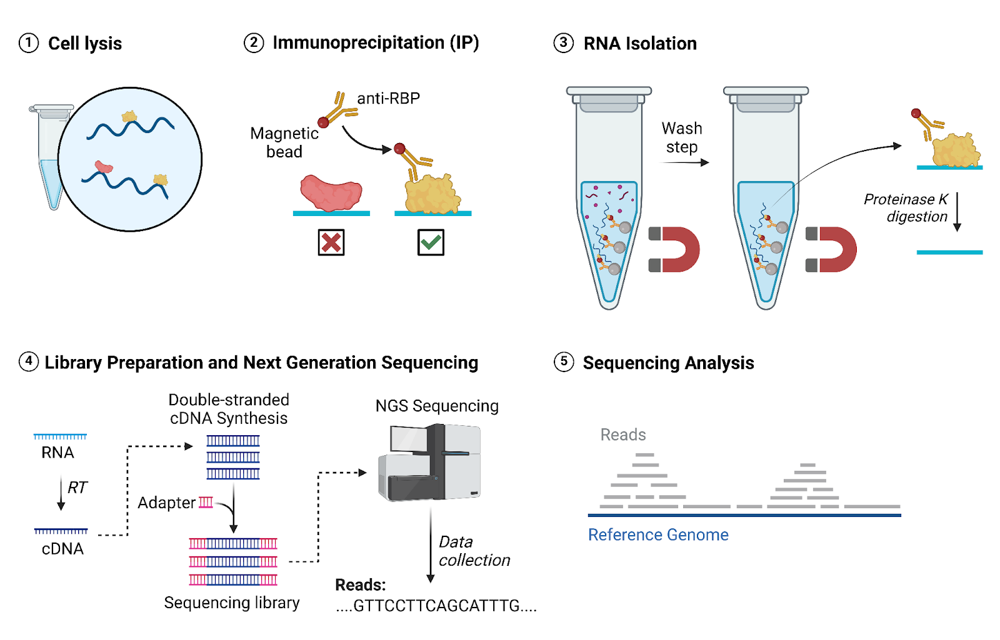
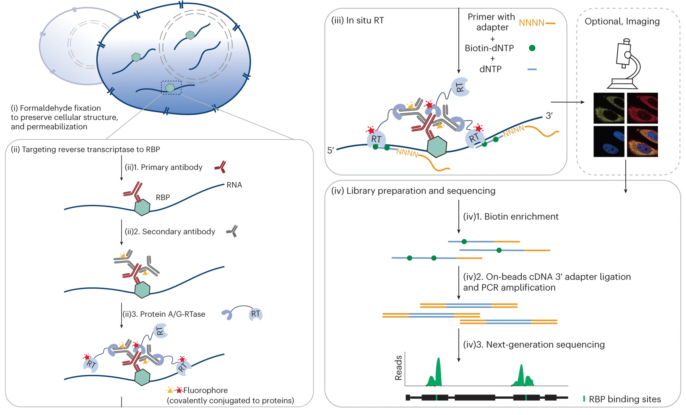

# Introduction

**RNA-binding proteins (RBPs)** are a vast and diverse class of proteins that interact with various RNA species through specific **RNA-binding domains (RBDs)**—such as the RNA Recognition Motif (RRM), KH domain, or Zinc fingers. These proteins typically assemble with RNAs into **ribonucleoprotein (RNP) complexes**, serving as the primary executors of **post-transcriptional regulation**. RBPs govern every stage of the RNA "life cycle," including alternative splicing, nuclear export, subcellular localization, stability (decay), and translation efficiency. By dynamically sensing cellular signals, RBPs integrate gene expression programs to maintain homeostasis; consequently, their dysregulation is frequently linked to cancer, neurodegeneration, and metabolic disorders.

## Library Strategy

### RIP-seq

RIP-seq (RNA immunoprecipitation sequencing) is a robust high-throughput technique used to identify RNA molecules associated with a specific RNA-binding protein (RBP) or ribonucleoprotein (RNP) complex. The method is based on immunoprecipitation using a protein-specific antibody to isolate the target protein together with its bound RNA from cell lysates. The workflow typically involves cell lysis, immunoprecipitation of protein–RNA complexes, protein digestion, RNA purification, and subsequent sequencing. A key feature of RIP-seq is its ability to capture physiologically relevant RNA–protein interactions in a transcriptome-wide context.

<figure style="text-align: center;">
	
	<figcaption>
        RIP-Seq Experimental Process. (Image created by author using BioRender)
    </figcaption>
</figure>


### CLIP-seq

CLIP-seq (Cross-linking Immunoprecipitation sequencing), also known as HITS-CLIP, is a powerful technique designed to map the precise, single-nucleotide binding sites of RNA-binding proteins (RBPs) across the transcriptome. Its principle hinges on the use of UV cross-linking (typically at 254 nm) to create irreversible covalent bonds between RBPs and their cognate RNA targets that are in direct physical contact. The workflow involves UV irradiation of live cells, partial RNA digestion (to narrow down the binding site), immunoprecipitation of the RBP-RNA complex, and the use of Proteinase K to leave a small "peptide scar" at the cross-link site. During reverse transcription, this scar often induces mutations or truncations, which serve as diagnostic markers for the exact binding location. Its defining characteristic is the ability to eliminate non-specific "background" interactions (thanks to the stringent washing allowed by covalent bonds) and provide unparalleled spatial resolution.

> - Procedure
> 	1. UV Crosslinking: Exposing cells to UV forms permanent covalent bonds between RBPs and their target RNA molecules.
> 	2. Cell Lysis: After crosslinking, the cells are lysed to release the RNA-protein complexes.
> 	3. RNA Fragmentation: The sample is then treated with limited amounts of RNases to fragment the RNA into smaller pieces. Fragmentation is performed to create RNA fragments of manageable size for later steps in the workflow.
> 	4. Immunoprecipitation
> 	5. RNA Isolation
> 	6. Sequencing

### ARTR-seq

ARTR-seq (Antibody-paired Reverse Transcription sequencing) is an innovative, high-sensitivity method designed to map the binding landscapes of RNA-binding proteins (RBPs) across the transcriptome. Its principle leverages an antibody-nucleic acid conjugate (an antibody "paired" with a DNA primer) to initiate in situ reverse transcription specifically on the RNA fragments associated with the target RBP. The workflow involves fixing cells with formaldehyde or UV, permeabilization, and incubating with a DNA-labeled antibody; this primer then guides the synthesis of cDNA directly from the bound RNA, which is then amplified for sequencing. The defining characteristic of ARTR-seq is its exceptional sensitivity and low input requirement, allowing researchers to generate high-quality RBP-binding profiles from as few as 1,000 cells—a feat traditionally difficult for standard CLIP-seq or RIP-seq protocols.

<figure style="text-align: center;">
	
	<figcaption>
		Scheme of ARTR-seq (Xiao, Y.,Nat Methods, 2024)
	</figcaption>
</figure>

### Others
> 1. tRIP-seq
> 	- The targeted RNA immunoprecipitation sequencing (tRIP-seq) method can detect protein-RNA interaction sites in thousands of cells. tRIP-seq's high sensitivity enables the identification of protein–RNA interactions at functional subcellular levels.
> 2. LACE-seq
> 	- The LACE-seq method is used to identify RNA networks regulated by RBPs at or near the single-oocyte level. This method couples RBP-mediated reverse transcription termination with the linear amplification of complementary DNA ends and sequencing.
> 3. RT&Tag
> 	- Reverse Transcribe and Tagment (RT&Tag) involves targeting RNAs associated with a chromatin epitope using an antibody, followed by a protein A-Tn5 transposome. Localized reverse transcription creates RNA/cDNA hybrids that are then tagged by Tn5 transposases for subsequent sequencing.
> 4. MAPIT-seq
> 	- Modification added to RBP interacting transcript-sequencing (MAPIT-seq), which uses an antibody-directed editing strategy to map genome-wide in situ RBP–RNA interactions and gene expression concurrently.

---

# Data Preprocessing

For more details, please see: [[NGS-21-Transcriptomics-GeneExpression]]

---

# Upstream Processing

## *Workflow 1:* RIP-seq

### 1. Alignment

#### 1). [STAR](https://github.com/alexdobin/STAR)

```shell
# Paired-end sequencing
STAR --runThreadN {threads} --genomeDir {input.index} \
	--readFilesIn {input.fq1} {input.fq2} --readFilesCommand zcat \
	--outSAMattributes All --outSAMtype BAM Unsorted \
	--outFileNamePrefix {params.prefix}.
```

#### (2). [HISAT2](https://daehwankimlab.github.io/hisat2)

```shell
# Paired-end sequencing
hisat2 -p {threads} -x {input.index} -1 {input.fq1} -2 {input.fq2} \
	--new-summary --summary-file {output.summary} | \
	samtools sort -@ 2 -n -O bam -o {output.bam}

# --rna-strandness <RF|FR>
```

### 2. Post-alignment Processing

#### Remove PCR Duplicates (Optional)

```shell
# bam sorting by query name
samtools fixmate -@ 1 -m -u {input} - | \
	samtools sort -@ 2 -u - | \
	samtools markdup -@ 1 -r \
	-f {output.rmdupstat} - {output.bam}
```

```shell
# bam sorting by coordinate (recommend)
samtools sort -@ {threads} {input.bam} -o {output.sorted_bam}
picard MarkDuplicates --REMOVE_DUPLICATES true \
	-I {input.bam} -O {output.rmdup_bam} -M {output.rmdupstat}
```

```shell
sambamba view -t {threads} -f bam \
	-F "[XS] == null and not unmapped and not duplicate" \
	{input.bam} > {output.rmdup_bam}

# [XS] == null:		filtered out multimappers for Bowtie2 result
# not unmapped:		filtered out unmapped reads
# not duplicate:	filtered out duplicates reads

sambamba markdup -t {threads} -r {input.bam} {output.rmdup_bam}
```

```shell
# Remove PCR duplicates by UMI
umi_tools dedup --method unique \
	--output-stats={output.stats.dir} \
	-L {log} --temp-dir={params.temp} \
	-I {input.bam} -S {output.rmdup.bam}
```

#### Filter Unique Mappings

```shell
# Keep uniquely mapped reads
samtools view -@ 1 -h -u -q 30 -f 2 -F 256 {input.bam} | \
	samtools sort -@ 2 -o {output.bam}
```

#### SStrand-Specific Separation (Optional)

```shell
# Using XS-tag based splitting method (Hisat2)
samtools view -h {input.rmdup_bam} | \
	tee >(awk '/^@/ || /XS:A:\\+/' | \
	samtools view -bS - | \
	samtools sort -@ {threads} -o {output.plus_bam}) | \
	awk '/^@/ || /XS:A:\\-/' | \
	samtools view -bS - | \
	samtools sort -@ {threads} -o {output.minus_bam}

# Using FLAG-based splitting method (STAR)
samtools merge -u - \
	<(samtools view -@ {threads} -b -f 80 {input.rmdup_bam}) \
	<(samtools view -@ {threads} -b -f 128 -F 16 {input.rmdup_bam}) | \
	samtools sort -@ {threads} -o {output.plus_bam}
samtools merge -u - \
	<(samtools view -@ {threads} -b -f 64 -F 16 {input.rmdup_bam}) \
	<(samtools view -@ {threads} -b -f 144 {input.rmdup_bam}) | \
	samtools sort -@ {threads} -o {output.minus_bam}

# ARTR-seq
samtools view -@ 1 -F 16 {input.bam} -b -o {output.fwd.bam}
samtools view -@ 1 -f 16 {input.bam} -b -o {output.rev.bam}
```

### 3. Peaks Calling

#### 1). [MACS2](https://github.com/macs3-project/MACS)

```shell
# Unstranded Library
macs2 callpeak -f BAM --nomodel -g hs --keep-dup all \
	--extsize 150 -q 0.05 --cutoff-analysis \
	-t {input.ip.bam} -c {input.input.bam} \
	-n {params.sample} --outdir {params.dir}
```

```shell
# Strand-specific library
macs2 callpeak -f BAM --nomodel -g 1.3e8 --keep-dup all \
	--extsize 150 -q 0.05 --cutoff-analysis \
	-t {input.ip_bam[0]} -c {input.input_bam[0]} \
	-n {wildcards.sample}_plus --outdir {params.output_dir}
macs2 callpeak -f BAM --nomodel -g 1.3e8 --keep-dup 1 \
	--extsize 150 -q 0.05 --cutoff-analysis \
	-t {input.ip_bam[1]} -c {input.input_bam[1]} \
	-n {wildcards.sample}_minus --outdir {params.output_dir}

cat <(awk 'BEGIN {{OFS="\t"}} {{ $6="+"; print }}' {sample}_plus_peaks.narrowPeak) \
	<(awk 'BEGIN {{OFS="\t"}} {{ $6="-"; print }}' {sample}_minus_peaks.narrowPeak) \
	> {output.peaks}
cat <(awk 'BEGIN {{OFS="\t"}} {{ $6="+"; print }}' {sample}_plus_summits.bed) \
	<(awk 'BEGIN {{OFS="\t"}} {{ $6="-"; print }}' {sample}_minus_summits.bed) \
	> {output.summits}
```

#### 2). [exomePeak2](https://github.com/ZW-xjtlu/exomePeak2)

```R
library(exomePeak2)
exomePeak2(
    bam_ip = ip.bam, bam_input = input.bam, 
    paired_end = TRUE, library_type = "1st_strand", 
    genome = "hg38", gff_dir = gtf, save_dir = output, 
    p_cutoff = 1e-5, log2FC_cutoff = 1, parallel = threads
)
```

#### 3). [MeTPeak](https://github.com/compgenomics/MeTPeak)

```R
library(MeTPeak)
metpeak(
    GENE_ANNO_GTF = gtf, EXPERIMENT_NAME = sample_id, 
    IP_BAM = ip.bam, INPUT_BAM = input.bam, 
    PEAK_CUTOFF_FDR = 0.05, FOLD_ENRICHMENT = 1, FRAGMENT_LENGTH = 150
)
```

## *Workflow 2:* ARTR-seq

### [ARTR-seq pipeline](https://github.com/mingming-cgz/ARTR-seq)

```shell
# ARTR-seq
# Paired-end sequencing
cutadapt -j {threads} --nextseq-trim 20 --action=trim \
	-a AGATCGGAAGAGCACACGTCTGAACTCCAG -A AGATCGGAAGAGCGTCGTGTAGGGAAAGAG \
	-o {output.fq1} -p {output.fq2} {input.fq1} {input.fq2}
cutadapt -j {threads} -q 20 -m 20 --action=trim \
	-u 8 -u -4 -U -8 -U 4 --rename='{id}_{r1.cut_prefix} {comment}' \
	-o {output.fq1} -p {output.fq2} {input.fq1} {input.fq2}

# Single-end sequencing
cutadapt -j {threads} --nextseq-trim=20 --action=trim \
	-a AGATCGGAAGAGCACACGTCTGAACTCCAG \
	-o {output.fq} {input.fq}
cutadapt -j {threads} -q 20 -m 20 --action=trim \
	-u 8 -u -4 --rename='{id}_{cut_prefix} {comment}' \
	-o {output.fq} {input.fq}
```

```shell
# Trim adapters and low-quality bases using Cutadapt
cutadapt -j {threads} --nextseq-trim=20 --action=trim \
	-a AGATCGGAAGAGCACACGTCTGAACTCCAG -A AGATCGGAAGAGCGTCGTGTAGGGAAAGAG \
	-o {output.fq1} -p {output.fq2} {input.fq1} {input.fq2}

# Additional quality trimming, length filtering, and read renaming
cutadapt -j {threads} -q 20 -m 20 --action=trim \
	-u 8 -u -4 -U -8 -U 4 --rename='{id}_{r1.cut_prefix} {comment}' \
	-o {output.fq1} -p {output.fq2} {input.fq1} {input.fq2}

# Align reads to the reference genome using STAR
STAR --runMode alignReads --runThreadN {threads} --genomeDir {input.index} \
	--readFilesIn {input.fq1} {input.fq2} --readFilesCommand zcat \
	--outSAMattributes All --outSAMtype BAM SortedByCoordinate \
	--alignMatesGapMax 15000 --outFilterMultimapNmax 1 \
	--outFilterScoreMin 10 --outFilterMatchNmin 24 \
	--alignEndsType EndToEnd --quantMode TranscriptomeSAM \
	--genomeLoad NoSharedMemory --outReadsUnmapped Fastx \
	--outFilterType BySJout --outFileNamePrefix {params.prefix}.

# Index the sorted BAM file for efficient access
samtools index {input.bam}

# Remove PCR duplicates using UMI-tools
umi_tools dedup --method unique -I {input.bam} -L {log} \
	--output-stats {output.dedup} -S {output.bam}

# Call peaks with MACS3
macs3 callpeak -f BAM --nomodel -g hs --keep-dup all \
	--extsize 30 -q 0.05 --cutoff-analysis \
	-t {input.ip.bam} -c {input.input.bam} \
	-n {params.sample} --outdir {params.dir}
```

## Generate Coverage Profiles

### 1). [deepTools](https://deeptools.readthedocs.io/en/develop/)

```shell
# Generate coverage BigWig from BAM
bamCoverage -p {threads} --binSize 10 --extendReads --centerReads \
	--normalizeUsing {params.normalize} \
	-b {input.bam} -o {output.bw}
bamCoverage -p {threads} --binSize 10 --extendReads --centerReads \
	--normalizeUsing RPGC --effectiveGenomeSize 2150570000 \
	-b {input.bam} -o {output.bw}
```

```shell
# Compare two BAM files and generate a log2 ratio BigWig track
bamCompare -p {threads} --binSize 10 --extendReads --centerReads \
	--scaleFactorsMethod None --normalizeUsing RPKM --operation log2 \
	-b1 {ip.bam} -b2 {input.bam} -o {output.bw}
```

## Quantification

### 1). deepTools

```shell
cat *narrowPeak | sort -k1,1 -k2,2n -k3,3n - | \
	bedtools merge -i - -c 5 -o count,max | \
	awk 'BEGIN {OFS="\t"} { $4="peak" NR; print }' > merged.bed
```

```shell
multiBigwigSummary BED-file -p {threads} -b {input.bam} --BED {targetRegion.bed} \
	--labels {sample} -o <result.npz> --outRawCounts <result.tsv>
multiBigwigSummary bins -bs 500 -p {threads} --bwfiles {input.bw} \
	--labels {sample} -o <result.npz> --outRawCounts <result.tsv>
```

### 2). bedtools
```shell
bedtools multicov -bams {input.bam} -bed {targetRegion.bed} > {prefix.peakCounts.txt}	
```

***

# Downstream Analysis

For more details, please see: [[NGS-13-Epigenomics-HistoneModification]]

## 1. Handling Replicates

## 2. Peak Annotation

## 3. Motif Discovery

For details, please see: [Motif Analysis](06-ANL-02-Motif_Analysis.md)

```shell
findMotifsGenome.pl $extpeak ${genomeHomer2} $odir/ -p ${nc} -rna -S 10 -len 5,6,7,8,9 \
	-bg ${annoforHomer2}
```

## 4. Visualization
1. [deepTools](https://deeptools.readthedocs.io/en/develop/)
2. [Guitar](https://www.bioconductor.org/packages/release/bioc/html/Guitar.html)
3. EnrichedHeatmap
5. Genomics Browser
	1. [Integrative Genomics Viewer (IGV)](https://igv.org/)
	2. [WashU Epigenome Browser](https://epigenomegateway.wustl.edu/)
	3. [Gviz](https://bioconductor.org/packages/release/bioc/html/Gviz.html)

## 5. Differential Peaks
1. DESeq2
2. MeTDiff
```R
library(MeTDiff)
metdiff(
    GENE_ANNO_GTF = gtf, EXPERIMENT_NAME = sample_id,
    IP_BAM = control.ip.bam, INPUT_BAM = control.input.bam,
    TREATED_IP_BAM = treat.ip.bam, TREATED_INPUT_BAM = treat.input.bam,
    DIFF_PEAK_CUTOFF_PVALUE = 0.05
)
```

---

# Reference

1. Zhao, Jing et al. Genome-wide Identification of Polycomb-Associated RNAs by RIP-seq. Mol Cell. 2010 Dec 22;40(6):939-53. doi: 10.1016/j.molcel.2010.12.011
2. High-throughput sequencing of RNA isolated by CLIP (HITS-CLIP): Licatalosi, D., Mele, A., Fak, J. et al. HITS-CLIP yields genome-wide insights into brain alternative RNA processing. Nature 456, 464–469 (2008). https://doi.org/10.1038/nature07488
3. Photoactivatable-Ribonucleoside-Enhanced CLIP (PAR-CLIP): Hafner, Markus et al. Transcriptome-wide identification of RNA-binding protein and microRNA target sites by PAR-CLIP. Cell. 2010 Apr 2;141(1):129-41. doi: 10.1016/j.cell.2010.03.009
4. Individual-nucleotide resolution CLIP (iCLIP): König, J., Zarnack, K., Rot, G. et al. iCLIP reveals the function of hnRNP particles in splicing at individual nucleotide resolution. Nat Struct Mol Biol 17, 909–915 (2010). https://doi.org/10.1038/nsmb.1838
5. Enhanced CLIP (eCLIP): Van Nostrand, E., Pratt, G., Shishkin, A. et al. Robust transcriptome-wide discovery of RNA-binding protein binding sites with enhanced CLIP (eCLIP). Nat Methods 13, 508–514 (2016). https://doi.org/10.1038/nmeth.3810
6. Infrared-CLIP (irCLIP): Zarnegar, B., Flynn, R., Shen, Y. et al. irCLIP platform for efficient characterization of protein–RNA interactions. Nat Methods 13, 489–492 (2016). https://doi.org/10.1038/nmeth.3840
7. Jinjun Wu et al. ,Dynamics of RNA localization to nuclear speckles are connected to splicing efficiency.Sci. Adv.10,eadp7727(2024).DOI:10.1126/sciadv.adp7727
8. Xiao, Y., Chen, YM., Zou, Z. et al. Profiling of RNA-binding protein binding sites by in situ reverse transcription-based sequencing. Nat Methods 21, 247–258 (2024). https://doi.org/10.1038/s41592-023-02146-w
9. Masuda A, Kawachi T, Takeda JI, Ohkawara B, Ito M, Ohno K. tRIP-seq reveals repression of premature polyadenylation by co-transcriptional FUS-U1 snRNP assembly. EMBO Rep. 2020 May 6;21(5):e49890. doi: 10.15252/embr.201949890
10. Su, R., Fan, LH., Cao, C. et al. Global profiling of RNA-binding protein target sites by LACE-seq. Nat Cell Biol 23, 664–675 (2021). https://doi.org/10.1038/s41556-021-00696-9
11. Khyzha, N., Henikoff, S. & Ahmad, K. Profiling RNA at chromatin targets in situ by antibody-targeted tagmentation. Nat Methods 19, 1383–1392 (2022). https://doi.org/10.1038/s41592-022-01618-9
12. Cheng, QX., Xie, G., Zhang, X. et al. Co-profiling of in situ RNA-protein interactions and transcriptome in single cells and tissues. Nat Methods 22, 1824–1835 (2025). https://doi.org/10.1038/s41592-025-02774-4