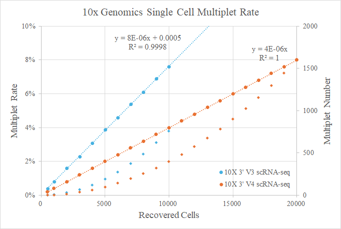

# Upstream Processing

## 10x Genomics

### scRNA-seq

> Cell Ranger 10.0.0 (Nov 13, 2025)

```shell
curl -o cellranger-10.0.0.tar.gz "https://cf.10xgenomics.com/releases/cell-exp/cellranger-10.0.0.tar.gz?Expires=1776781650&Key-Pair-Id=APKAI7S6A5RYOXBWRPDA&Signature=cWHglLsBahKO63Hn0r7E72IFbCWqkhGLy3e-e28C0cA1VGnygDMeVMQcjzLfQgrcXK2XNUnj8GzC9pMc1NrGDnjmboBvwuIfrpEgsUmdua5q3wcmZg0U6VT4gefEgpibZtQtVpSRaDs3jSJLcUPKdBU3eA1bMdAQq-kR6e-szj4~N7L7qoiewbxlioprhYCjmU4dOJvaA6OqqfUyodami2wnnGSKnis4hRiU--oCKqfNGMxUDVaR6bJJZZ9HJocC3e46l6~wot1of4jg-msYGZGNIyN95-Fnrc4o7JrCEsHECB1TSInTrE~OPRCEHqwq3jDNKRuqDanMxtrI3jLKXg__"

curl -O "https://cf.10xgenomics.com/supp/cell-exp/refdata-gex-GRCh38-2024-A.tar.gz"
curl -O "https://cf.10xgenomics.com/supp/cell-exp/refdata-gex-GRCm39-2024-A.tar.gz"
curl -O "https://cf.10xgenomics.com/supp/cell-vdj/refdata-cellranger-vdj-GRCh38-alts-ensembl-7.1.0.tar.gz"
curl -O "https://cf.10xgenomics.com/supp/cell-vdj/refdata-cellranger-vdj-GRCm38-alts-ensembl-7.0.0.tar.gz"
curl -O "https://cf.10xgenomics.com/supp/cell-exp/refdata-gex-mm10-2020-A.tar.gz"
```

```shell
# Bulid genome index

cellranger mkgtf {input.gtf} {output.gtf} \
    --attribute=gene_type:protein_coding \
    --attribute=gene_type:lncRNA \
    --attribute=gene_type:antisense \
    --attribute=gene_type:IG_LV_gene \
    --attribute=gene_type:IG_V_gene \
    --attribute=gene_type:IG_V_pseudogene \
    --attribute=gene_type:IG_D_gene \
    --attribute=gene_type:IG_J_gene \
    --attribute=gene_type:IG_J_pseudogene \
    --attribute=gene_type:IG_C_gene \
    --attribute=gene_type:IG_C_pseudogene \
    --attribute=gene_type:TR_V_gene \
    --attribute=gene_type:TR_V_pseudogene \
    --attribute=gene_type:TR_D_gene \
    --attribute=gene_type:TR_J_gene \
    --attribute=gene_type:TR_J_pseudogene \
    --attribute=gene_type:TR_C_gene

cellranger mkref \
	--nthreads {threads} \
    --memgb {memory.GB} \
    --genome {params.genome} \
    --fasta {input.fa} \
    --genes {input.gtf}
```

```shell
cellranger count --id {params.id} \
    --localcores {threads} \
    --localmem {memory.GB} \
    --transcriptome {params.index} \
    --fastqs {input.fq.dir} \
    --expect-cells 10000 \
    --create-bam true \
    --output-dir {params.outdir}
# --force-cells
```

### snATAC-seq

> Cell Ranger ATAC 2.2.0 (Apr 30, 2025)

```shell
curl -o cellranger-atac-2.2.0.tar.gz "https://cf.10xgenomics.com/releases/cell-atac/cellranger-atac-2.2.0.tar.gz?Expires=1776721025&Key-Pair-Id=APKAI7S6A5RYOXBWRPDA&Signature=XuU0UwDJwxvzU4Ah4ucHLAxbnILmM0RrxgOa0ib5W44~p63WOr1ZHQb9z7mae12QFUbYhBJwi1WLF5BnuGbRirJ1rTroq4xkfV3Tkx6TJmXT7EnK3LEjXbOrzdtu~oYBymFKZ9Z544-1kAACcj49bT5s0Rstm2CAisDQf~~t~DgQXUTssawYcz6~yysI53Iap7cvtewFPOPSs0Sn3MLWukTGTkRnWSIAf7D163nNMn8eAGRfgOfuT9gw-K1jSNdgveucrjZcOcguqtynuLTF-VeDgYzq-h9Fmly8L5MwSzYEuUOD7EGFmBKZj6-5vyQrnB1BHPzsVUFBZ6bYwDoieg__"

curl -O "https://cf.10xgenomics.com/supp/cell-arc/refdata-cellranger-arc-GRCh38-2024-A.tar.gz"
curl -O "https://cf.10xgenomics.com/supp/cell-arc/refdata-cellranger-arc-GRCm39-2024-A.tar.gz"
curl -O "https://cf.10xgenomics.com/supp/cell-arc/refdata-cellranger-arc-mm10-2020-A-2.0.0.tar.gz"
```

```shell
cellranger-atac count --id {params.prefix} \
    --localcores {threads} --localmem {memory.GB} \
    --reference {params.index} --fastqs {input.fq.dir} \
    --output-dir {params.outdir}
# --force-cells
```

> Cell Ranger ARC 2.2.0 (Apr 20, 2026)

```shell
curl -o cellranger-arc-2.2.0.tar.gz "https://cf.10xgenomics.com/releases/cell-arc/cellranger-arc-2.2.0.tar.gz?Expires=1776781877&Key-Pair-Id=APKAI7S6A5RYOXBWRPDA&Signature=FraD6uv5R94H-p4mzlxTJttiL5AFWv82bDE9Kg8SGIdoaTcnC0jSMS9FzDA-P-AG9r15nengFZYsCfM7fFWvB8FDWNG3Oq4lh74xdJF55MV3ykaGP2cS~~HcfgHEkIiQLyqsPEHpO1V86J62-32OsFvqePYhFpXZ6NomjsKRAGX79rr8tXCLaASBk9lSyEmUhNmTmzGT4VDdSq37AukKPbdov7NU0vZzcGKtbTUlSGKZ0v3wdOEt9omW~lRafNZmaGHXdMH2bSf8G28w3ZH6I1H~-Pf9M3qDX~lmjQfPfhE53BIN0Xux82eIuJDdKCOYfnofumDCi5XeSscgs-5RAA__"
```

> Space Ranger 4.1.0 (Apr 7, 2026)

```shell
curl -o spaceranger-4.1.0.tar.gz "https://cf.10xgenomics.com/releases/spatial-exp/spaceranger-4.1.0.tar.gz?Expires=1776781749&Key-Pair-Id=APKAI7S6A5RYOXBWRPDA&Signature=RyTawO7DtQHYXVGF0nQrppvPfK-8Y4I52YUGTV4LmwwoR8Qfk639WiCRp4JG1zDolmERZpE5bpKyC1GuIRTBfQBJgcGPhJXfUg1wh5urmzH7srQooTuvNLZicUEQGdXHifD~KKl8l3oLD-CmnoeBWEdKg6dHOiKhTvhD-dpnYwmFV2vtqpFZ89uOGRgK4n74M93EU~FJY~QSNZFI1xxa1z2Ctm~BjMEusfLkjlcavoBytf86QazT63LRNeh8uYKitXMf9FjCz46UyB13J-0ISeu9FCoIyqENv3kb2ILnFGZLH7g2W5TzauX~OW9vImj02grKn5FyhEpFHP0ol0mEzA__"
```

## DNBelab-C4

> dnbc4tools v3.1 (2026-05-15), [GitHub Repository](https://github.com/MGI-tech-bioinformatics/DNBelab_C_Series_HT_scRNA-analysis-software)

### scRNA-seq

```shell
# Filter GTF
dnbc4tools tools mkgtf \
	--ingtf {input.gtf} \
	--output {output.filtered.gtf}
# [default: protein_coding,lncRNA,lincRNA,antisense,IG_*,TR_*]

# Bulid genome index
dnbc4tools rna mkref \
	--threads {threads} \
	--fasta {input.fa} \
	--ingtf {input.filtered.gtf} \
	--genomeDir {output.dir} \
	--species {output.prefix}
```

```shell
# Method 1
dnbc4tools rna run \
	--threads {threads} \
	--calling_method emptydrops \
	--expectcells 10000 \
	--fastqs {input.fastqs.dir} \
	--genomeDir {input.index} \
	--outdir {output.dir} \
	--name {output.prefix}

# Method 2
dnbc4tools rna run \
	--threads {threads} \
	--calling_method emptydrops \
	--expectcells 10000 \
	--cDNAfastq1 {input.cDNA_R1.fq.gz} \
	--cDNAfastq2 {input.cDNA_R2.fq.gz} \
	--oligofastq1 {input.oligo_R1.fq.gz} \
	--oligofastq2 {input.oligo_R2.fq.gz} \
	--genomeDir {input.index} \
	--outdir {output.dir} \
	--name {output.prefix}

# --forcecells
```

### snATAC-seq

```shell
# Bulid genome index
dnbc4tools atac mkref \
	--fasta {input.fa} \
	--ingtf {input.filtered.gtf} \
	--genomeDir {output.dir} \
	--species {output.prefix}
```

```shell
# Method 1
dnbc4tools atac run \
	--threads {threads} \
	--need_bam \
	--fastqs {input.fastqs.dir} \
	--genomeDir {input.index} \
	--outdir {output.dir} \
	--name {output.prefix}
	
# Method 2
dnbc4tools atac run \
	--threads {threads} \
	--need_bam \
	--fastq1 {input.L1.fq1},{input.L2.fq1} \
	--fastq2 {input.L1.fq2},{input.L2.fq2} \
	--genomeDir {input.index} \
	--outdir {output.dir} \
	--name {output.prefix}
```

### scVDJ-seq

> 5' RNA
> TCR
> BCR

```shell
dnbc4tools rna run \
	--threads {threads} \
	--calling_method emptydrops \
	--expectcells 10000 \
	--end5 \
	--fastqs {input.rna.fastqs.dir} \
	--genomeDir {input.index} \
	--outdir {output.dir} \
	--name {output.prefix}

dnbc4tools vdj run \
	--threads {threads} \
	--ref mouse \
	--chain TR \
	--fastqs {input.tcr.fastqs.dir} \
	--beadstrans {input.rna.result.singlecell.csv}
	--outdir {output.dir} \
	--name TCR

dnbc4tools vdj run \
	--threads {threads} \
	--ref mouse \
	--chain IG \
	--fastqs {input.bcr.fastqs.dir} \
	--beadstrans {input.rna.result.singlecell.csv}
	--outdir {output.dir} \
	--name BCR
```

## Smart-seq2

```shell
trim -> star -> featureCount (ERCC, UMI etc.)
```

## CITE-seq

[CITE-seq-Count](https://github.com/Hoohm/CITE-seq-Count)

***

# scRNA-seq Downstream Analysis

## Common Tools

### 1. [Seurat](https://github.com/satijalab/seurat)
Seurat v2: 2017-07-18
Seurat v3: 2019-04-16
Seurat v4: 2021-02-01
Seurat v5: 2023-11-05
### 2. Scanpy

### 3. Bioconductor Toolkits

### 4. [Monocle3](https://github.com/cole-trapnell-lab/monocle3)

## Analysis Workflow


### 1. Data Import

#### SingleCellExperiment


#### Seurat

#### Anndata

[Anndata](https://anndata.readthedocs.io/en/stable/): anndata is a **Python** package for handling annotated data matrices in memory and on disk, positioned between pandas and xarray.


### 2. Quality Control

#### 1). QC Metrics

A key assumption here is that the QC metrics are independent of the biological state of each cell.

> 1. The number of counts (UMI) per barcode
> 2. The number of features per barcode
> 3. The fraction of counts from mitochondrial genes per barcode
> 4. The fraction of counts from ribosomal genes per barcode
>   - L ribosomal proteins (RPL)
>   - S ribosomal proteins (RPS)
>   - Mitochondrial ribosomal proteins (MRP)
> 5. The fraction of counts from hemoglobin genes per barcode
>   - Human, [Human gene group](https://www.genenames.org): HBA1|HBA2|HBAP1|HBB|HBBP1|HBD|HBE1|HBG1|HBG2|HBM|HBQ1|HBZ|HBZP1
>   - Mouse: Hba-a1|Hba-a2|Hba-ps3|Hba-ps4|Hba-x|Hbb-bh0|Hbb-bh1|Hbb-bh2|Hbb-bh3|Hbb-bs|Hbb-bt|Hbb-y|Hbq1a|Hbq1b
> 6. The fraction of counts from spike-in transcripts per barcode
>   - ERCC

#### 2). Doublet Detection

Doublets are defined as two cells that share the same cellular barcode. Depending on whether they originate from the same cell type or cell state, they can be classified as homotypic or heterotypic. The primary goal of doublet detection methods is to identify heterotypic doublets. There are two main types of doublet detection methods: one relies on high read counts and detected features; the other uses artificially constructed pairs and compares them with cells in a dataset. 

Because **plate-based** typically have few cells and a low twin-cell rate, common practices include simple filtering using QC indicators such as total cell expression level or gene count, or avoiding co-capture during experimental design.

| Method | Principle | Implementation | Notes | Releases |
|  -  |  -  |  -  |  -  |  -  |
| [DoubletFinder](https://github.com/chris-mcginnis-ucsf/DoubletFinder) | Simulation+KNN density | R / Seurat | recommend | 2025 |
| [scDblFinder](https://github.com/plger/scDblFinder) | Integrated multi-strategy (simulation + density + GBM) | R | recommend | 2025 |
| [DoubletDetection](https://github.com/JonathanShor/DoubletDetection) | Clustering-based enrichment + hypergeometric test | Python | - | 2025 |
| [scds](https://github.com/kostkalab/scds) | Gene co-expression (cxds) and classifier-based simulation (bcds) | R | - | 2022 |
| [DoubletDecon](https://github.com/EDePasquale/DoubletDecon) | Deconvolution-based reconstruction | R | - | 2020 |
| [Scrublet](https://github.com/swolock/scrublet) | Simulation+KNN classification | Python | - | 2020 |
| [solo](https://github.com/calico/solo) | Deep learning (scVI latent space + neural classifier) | Python | - | 2024 |
| [scran::doubletCells](https://github.com/MarioniLab/scran) | Simulation-based density (scran) | R (scran) | - | 2024 |
| [Vaeda](https://github.com/kostkalab/vaeda) | Variational autoencoder + PU learning | Python | - | 2024 |
| [Chord](https://github.com/13308204545/Chord) | Ensemble of multiple doublet detection methods | R / Python | - | 2022 |



#### 3). Filtering Low-quality Cells

fixed thresholds:

adaptive thresholds: median absolute deviation (MAD)

robustbase:

1. Low-quality cells: Cells with a low number of detected genes, a low count depth and a high fraction of mitochondrial counts are typically termed low-quality cells as they can represent dying cells with broken membranes.
  - manually setting thresholds
  - sample-wise automatic filtering based on the number of median absolute deviations
2. Cell-free RNA: blend different cell populations together
  - SoupX estimate the cell-specific contamination fraction on the basis of the expression profiles of otherwise ‘empty’ droplets and cell clusters in the data set
  - CellBender formulates the removal of ambient RNA as an unsupervised Bayesian model that requires no prior knowledge of cell-type-specific gene expression profiles
3. Empty droplets and doublets


> - Samuel L. Wolock, Romain Lopez, and Allon M. Klein. Scrublet: computational identification of cell doublets in single-cell transcriptomic data. Cell Systems, 8(4):281–291.e9, apr 2019. URL: https://doi.org/10.1016/j.cels.2018.11.005, doi:10.1016/j.cels.2018.11.005


 Filtering Empty Droplets

Remove empty droplets and very low coverage cells to avoid affecting double cell recognition

ambient RNA

empty droplets

[DropletUtils](https://github.com/MarioniLab/DropletUtils): Loading from count matrices or molecule information files, identification of cells from empty droplets, removal of barcode-swapped pseudo-cells, and downsampling of the count matrix.


#### 2. Noise Correction

##### (1). Cell cycle effect

Seurat suggest regressing out the difference between the G2M and S phase scores. This means that signals separating non-cycling cells and cycling cells will be maintained, but differences in cell cycle phase among proliferating cells will be regressed out of the data.

```R
scrna$CC.Difference <- scrna$S.Score - scrna$G2M.Score
scrna <- ScaleData(scrna, features = Features(scrna), vars.to.regress = "CC.Difference", verbose = FALSE)
```

##### (2) Dissociation-induced gene

- van den Brink, S., Sage, F., Vértesy, Á. et al. Single-cell sequencing reveals dissociation-induced gene expression in tissue subpopulations. Nat Methods 14, 935–936 (2017). https://doi.org/10.1038/nmeth.4437

##### (3). Batch effect

##### Evaluate noise

##### Filter Genes (Optional)

- Mitochondrial genes

### 3. Normalization

A theoretically and empirically established model for UMI data is the Gamma-Poisson distribution.

#### (1). LogNormalize

Global-scaling normalization method “LogNormalize” that normalizes the feature expression measurements for each cell by the total expression, multiplies this by a scale factor (10,000 by default), and log-transforms the result. Global-scaling relies on an assumption that each cell originally contains the same number of RNA molecules. one normalizes the feature expression measurements for each cell to the total expression, and then multiplies this by a scale factor (10000 by default). At the end, the resulting expression levels are log-transformed so that the expression values better fit a normal distribution.


The common suggestion is not to perform any regress-out in the first iteration of data exploration, but first check the result, and if any unwanted source of variation dominates the cellular heterogeneity, try to regress out the respective variable and see whether the result improves.

#### (2). SCTransform

A modeling framework for the normalization and variance stabilization of molecular count data from scRNA-seq experiments. This procedure omits the need for heuristic steps including pseudocount addition or log-transformation and improves common downstream analytical tasks such as variable gene selection, dimensional reduction, and differential expression.

A modeling framework for the normalization and variance stabilization of molecular count data from scRNA-seq experiments. This procedure omits the need for heuristic steps including pseudocount addition or log-transformation and improves common downstream analytical tasks such as variable gene selection, dimensional reduction, and differential expression.

There are some scenarios in which trying SCTransform would be recommended. For instance, you might perform a differential expression analysis between cells of two conditions, and the results show a dramatic bias in DE, i.e. a huge amount of genes with increased expression but very few genes with decreased expression. If the data for the two conditions shows very different coverage (e.g. the condition with a lot of decreased expression shows significantly smaller number of detected gene/transcript numbers), such a biased DE result may be indeed an artifact introduced by the standard normalization procedure. In this case, using SCTransform may help to reduce the artifact.

### 4. Dimensionality Reduction

#### Linear methods (for Analysis)

##### PCA

Principal components analysis (PCA)

#### Non-linear methods (for Visualization)

##### t-SNE

t-stochastic neighbor embedding (t-SNE)

##### UMAP

Uniform manifold approximation and projection (UMAP)

### 5. Integrate Data

#### Integration steps

1. Dimensionality reduction
2. Modeling and removing the batch effect
3. Projection back into a high-dimensional space

#### Integrate method

1. **Global models**
    1. ComBat (bulk RNAseq)
2. **Linear embedding models**
    1. Mutual nearest neighbors (MNN)
    2. Seurat integration
    3. [Scanorama](https://github.com/brianhie/scanorama)
    4. [Harmony](https://portals.broadinstitute.org/harmony/)
3. **Graph-based methods**
    1. Batch-Balanced _k_-Nearest Neighbor (BBKNN)
4. **Deep learning (DL) approaches**
    1. [scVI](https://github.com/scverse/scvi-tools)
    2. scGen
    3. scANVI
    Luecken, M.D., Büttner, M., Chaichoompu, K. _et al._ Benchmarking atlas-level data integration in single-cell genomics. _Nat Methods_ **19**, 41–50 (2022). https://doi.org/10.1038/s41592-021-01336-8

### 6. Clustering

#### Graph-based clustering method
Louvain
Leiden


#### Hierachical clustering methods

#### Partition-based
k-means

#### Gaussian mixture models


### 6). Find Different Express Genes

### 7. Cell Annotation

#### 1). Manual Annotation

> - **Marker Genes**
Cell population annotation based on differentially expressed genes in clusters and cell type marker genes.
> - [Annotation of cell types (ACT)](http://xteam.xbio.top/ACT): Web
Quan, F., Liang, X., Cheng, M. et al. Annotation of cell types (ACT): a convenient web server for cell type annotation. Genome Med 15, 91 (2023). https://doi.org/10.1186/s13073-023-01249-5


#### 2). Automatic annotation using reference markers

> - [scCATCH](https://github.com/ZJUFanLab/scCATCH): R, 2023
scCATCH (R) from cluster marker gene identification to cluster annotation based on an evidence-based score by matching the identified potential marker genes with known cell markers in a tissue-specific cell taxonomy reference database (CellMatch).
> - [CellAssign](https://github.com/Irrationone/cellassign): R, Tensorflow, 2020
Information about a priori known marker cell types is provided as input to the model in the form of a (binary) marker gene by cell-type matrix. cellassign then probabilistically assigns each cell to a cell type, removing subjective biases from typical unsupervised clustering workflows.
> - [ScType](https://github.com/IanevskiAleksandr/sc-type): R
ScType a computational method for automated selection of marker genes based merely on scRNA-seq data.
> - [SCINA](https://github.com/jcao89757/SCINA): R, 2020
> - [SCSA](https://github.com/bioinfo-ibms-pumc/SCSA): Python, 2023
> 

#### 3). Automatic annotation using a reference data

> - [SingleR](https://github.com/SingleR-inc/SingleR): R
SingleR leverages reference transcriptomic datasets of pure cell types to infer the cell of origin of each of the single cells independently.
> - [scMatch](https://github.com/asrhou/scMatch): Python, 2020
scMatch annotates individual cells directly by identifying the closest match in a large reference dataset.
> - [MapMyCells](https://github.com/AllenInstitute/cell_type_mapper): Python
MapMyCells uses mapping algorithms (correlation mapping, hierarchical correlation mapping, deep generative mapping) to determine which cell types their transcriptomics and spatial data correspond to by comparing their data to massive, high-quality reference datasets.
> - [celaref](https://www.bioconductor.org/packages/release/bioc/html/celaref.html): R
It compares the reference sample rankings of the most distinctly enriched genes in each query group to match cell types.
> - [scHCL](https://github.com/ggjlab/scHCL) or [scMCA](https://github.com/ggjlab/scMCA): R, 2020
> - [scmap](https://github.com/hemberg-lab/scmap): R, 2020
> - [scPred](https://github.com/powellgenomicslab/scPred): R, 2021

#### 4). Automatic annotation using AI models

> - [CellTypist](https://www.celltypist.org): Python
> - [scGPT](https://github.com/bowang-lab/scGPT): Python
> - [GPTCelltype](https://github.com/Winnie09/GPTCelltype): R
> - [Garnett](https://github.com/cole-trapnell-lab/garnett): R
Automatic cell annotation R package for building regression classification models.
> - [Cell Marker Accordion](https://github.com/TebaldiLab/cellmarkeraccordion): R
> - [CellAnnotator](https://github.com/quadbio/cell-annotator): Python

#### 5). Inference of ambiguous cell cluster

> - [scANVI](https://github.com/scverse/scvi-tools): Python
scANVI (single-cell ANnotation using Variational Inference; Python class SCANVI) is a semi-supervised model for single-cell transcriptomics data. In a sense, it can be seen as a scVI extension that can leverage the cell type knowledge for a subset of the cells present in the data sets to infer the states of the rest of the cells.

#### 6). Unknow
> - [CHETAH](https://github.com/jdekanter/CHETAH): R, 2019
> 

#### 6). Marker gene reference dataset

| Dataset | Organisms | Source | Notes |  |  |  |  |
| - | - | - | - | - | - | - | - |
| [CellMarker](http://xteam.xbio.top/CellMarker) |  |  |  |  |  |  |  |
| [CellMarker v2](http://bio-bigdata.hrbmu.edu.cn/CellMarker) |  |  |  |  |  |  |  |
| [Annotation of cell types (ACT)](http://xteam.xbio.top/ACT) | Homo sapiens, Mus musculus | cell marker entries form publications | | | | | |
| [celldex](https://github.com/SingleR-inc/celldex) | Homo sapiens, Mus musculus | bulk RNA-seq, Microarray (pure cell) |  |  |  |  |  |
| [PanglaoDB](https://panglaodb.se/) | Homo sapiens, Mus musculus | scRNA-seq |  |  |  |  |  |
| CancerSEA |  |  |  |  |  |  |  |
| Cell Ontology | | | | | | | |
| [Human Cell Atlas](https://www.humancellatlas.org) | | | | | | | |
| [Azimuth](https://azimuth.hubmapconsortium.org/) | Homo sapiens | scRNA-seq | | | | | |
| [The Allen Institute for Brain Science](https://brain-map.org) | Homo sapiens, Mus musculus | scRNA-seq | The Allen Institute for Brain Science | | | | |
| [The Allen Brain Cell (ABC) Atlas](https://brain-map.org/bkp/explore/abc-atlas) | Homo sapiens, Mus musculus | scRNA-seq | The Allen Institute for Brain Science | | | | |
|  |                            |                                       |                                       | | | | |
|  | | | | | | | |
|  | | | | | | | |
|  | | | | | | | |
|  | | | | | | | |
|  | | | | | | | |
|  | | | | | | | |
|  | | | | | | | |
|  | | | | | | | |
|  | | | | | | | |
|  | | | | | | | |
|  | | | | | | | |
|  | | | | | | | |

### 8. Cell Clusters Frequency

### 9. Trajectory Inference

1. [Monocle2](https://cole-trapnell-lab.github.io/monocle-release)
    - [CytoTRACE](https://github.com/digitalcytometry/cytospace) & [CytoTRACE 2](https://github.com/digitalcytometry/cytotrace2) 
2. [SCORPIUS](https://github.com/rcannood/SCORPIUS)
3. etc.

### 10. Gene Regulatory Networks

1. [SCENIC](https://github.com/aertslab/SCENIC)

### cell-cell communication
Cells communicate through direct contact or at a distance via ligand–receptor interactions. Cellular communication encompasses two essential processes: cell signal conduction for the generation and intercellular transmission of signals, and cell signal transduction for the reception and processing of signals.

Expression permutation-based tools:

Expression permutation-based tools employ various methods to calculate communication scores for each LRP and evaluate the comparative significance to a null model using clustering label arrangement, non-parametric testing, or empirical methods.

CellPhoneDB, CellChat, ICELLNET, SingleCellSignalR, CellCall and NATMI

Difference-assembly-based tools:

PyMINEr iTALK and CellTalker

Network-based analysis tools:

CCCExplorer, NicheNet, scMLnet, SoptSC, Scriabin, CytoTalk, RNA-Magnet and ContactTracing

Tensor-based analysis tools:

scTensor

Other principles and strategies:

MEBOCOST

Spatial transcriptome-based tools:

SpaOTsc, spaCI, stLearn, Giotto, MISTy, SVCA, SpaTalk, Tensor-Cell2Cell, HoloNet, COMMOT and NeuronChat

---

# scATAC-seq Downstream Analysis

## Common Tools

[Signac](https://github.com/stuart-lab/signac)

[Cicero](https://cole-trapnell-lab.github.io/cicero-release)

## Analysis Workflow

### 2. Quality Control

#### 1). QC Metrics

1. Nucleosome banding pattern
2. Transcriptional start site (TSS) enrichment score
3. Total number of fragments in peaks
4. Fraction of fragments in peaks (FRiP)
5. Ratio reads in genomic blacklist regions

### 3. Normalization

#### TF-IDF

Term frequency-inverse document frequency (TF-IDF) normalization
two-step normalization procedure:
> 1. normalizes across cells to correct for differences in cellular sequencing depth
> 2. across peaks to give higher values to more rare peaks

#### Feature selection

### 4. Linear Dimensionality Reduction

#### SVD

Singular value decomposition (SVD)

### Create a gene activity matrix

### Integrating with scRNA-seq


### Analysis

[epiVIA](https://github.com/wangwl/epiVIA): Vector Integration Analysis with epigenomic assays.

```shell
epiVIA --Vector vector.fa --ltr5_start 1 --ltr5_end 181 --ltr3_start 5271 --ltr3_end 5505 \
    --HostIndex $genomeFa --Host2bit hg38.2bit --tempdir ${outputDir} \
    --candidate_bam $outputDir/candidate.bam --chimera_bam $outputDir/chimera.bam \
    $scATACseq/possorted_bam.bam $outputDir
```


#### [chromVAR](https://github.com/GreenleafLab/chromVAR)

> chromVAR is an R package for the analysis of sparse chromatin accessibility data from single cell or bulk ATAC or DNAse-seq data. The package aims to identify motifs or other genomic annotations associated with variability in chromatin accessibility between individual cells or samples.
> - Schep, A., Wu, B., Buenrostro, J. et al. chromVAR: inferring transcription-factor-associated accessibility from single-cell epigenomic data. Nat Methods 14, 975–978 (2017). https://doi.org/10.1038/nmeth.4401
> - Chen, H., Lareau, C., Andreani, T. et al. Assessment of computational methods for the analysis of single-cell ATAC-seq data. Genome Biol 20, 241 (2019). https://doi.org/10.1186/s13059-019-1854-5

---

# Reference

Heumos, L., Schaar, A.C., Lance, C. *et al.* Best practices for single-cell analysis across modalities. *Nat Rev Genet* **24**, 550–572 (2023). https://doi.org/10.1038/s41576-023-00586-w
