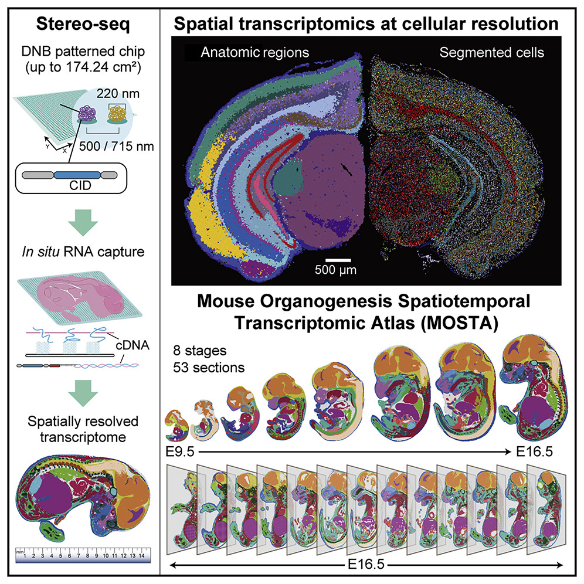
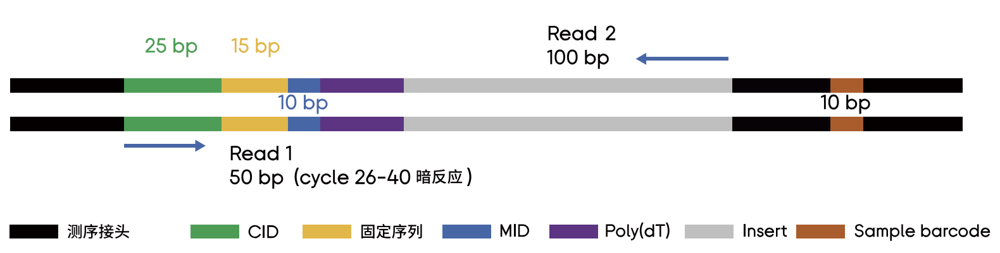
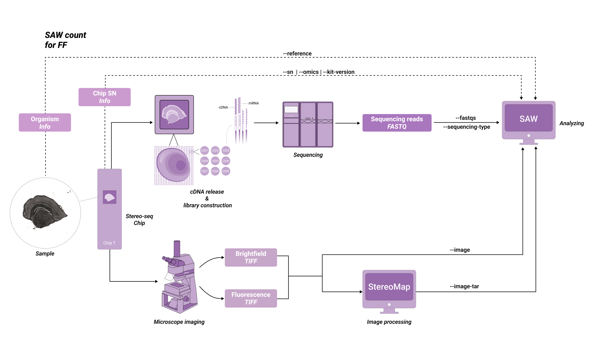
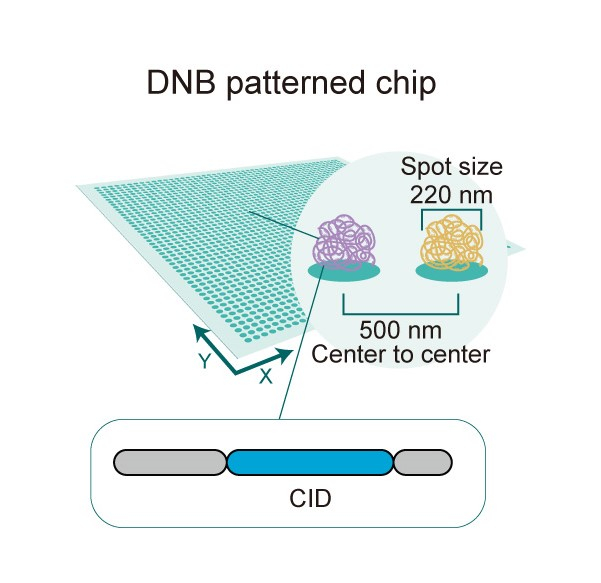

# Introduction

## Spatial Transcriptomics Technologies

<figure style="text-align: center; margin: 2rem 0;">
    
    <figcaption style="font-size: 0.9rem; color: #555; margin-top: 0.5rem;">
        <strong>Figure.</strong> Schematic workflow and structural overview. 
        Adapted from <a href="https://doi.org/10.1016/j.csbj.2023.01.015" target="_blank" rel="noopener noreferrer">Computational and Structural Biotechnology Journal</a>.
    </figcaption>
</figure>

### 1. ISH-based technologies

In situ hybridization (ISH)-based spatial transcriptomic techniques are a category of techniques that can profile transcriptomes while preserving the spatial locations of transcripts by hybridizing labeled complementary probes to mRNAs of interest. ISH-based techniques are typically efficient in terms of detection but costly in terms of experimentation. The unique design of the probe for MERFISH was a peak in the uniqueness of the probe design scheme for this type of technology, followed by a similar coding scheme for seqFISH+.

### 2. ISS-based technologies

Sequencing RNA molecules directly in tissues is the technical task of the spatial transcriptome, and In situ sequencing (ISS)-based approaches yield spatial localization of the transcriptome by sequencing.
ISS-based techniques are designed to detect minute amounts of transcriptomic signals by cycling and amplifying them. ISS-based experiments were upgraded to include roll-loop generation and signal reading, with STARmap minimizing background interference and BOLORAMIS reducing errors by reducing the number of reverse transcription steps.

### 3. Sequencing-based technologies

The spatial information in the tissue can also be localized by precise pre-selection, and then the tissue to be sequenced can be obtained by sectioning. Tissue sections are placed on a specially designed slide capable of capturing RNA and then sequenced for analysis.


### 4. Spatial information reconstruction technologies

## Commercial technologies

### 1. STOmics Stereo-seq

STOmics' proprietary Stereo-seq (SpaTial Enhanced REsolution Omics-sequencing) technology provides researchers with a new tool to investigate spatial biology. Stereo-seq facilitates the in-situ capture of RNA information within tissue on the chip and subsequently restores cellular spatial locational data through spatial coordination barcoding (Coordinate ID, CID).







| Technology                  | V1.3                                                |
| --------------------------- | --------------------------------------------------- |
| Capture method              | Poly(A)-based                                       |
| Sample types                | FF                                                  |
| Capture areas               | 5 mm * 5 mm, 10 mm * 10 mm                          |
| Spot diameter / Square size | 220 nm                                              |
| Spot center distance        | 500 nm                                              |
| Pre capture area            | -                                                   |
| Spatial resolution          | Single-cell segmentation (Cellbin）or Bin 20 (10 µm) |
| Multiomic                   | -                                                   |

### 2. 10X Genomics Visium

The Visium platform delivers unbiased, whole transcriptome spatial gene expression analysis at single cell scale with unmatched spatial data quality and offers a flexible assay portfolio to study a broad range of tissues.

| Technology                  | Visium V1       | Visium V2                      | Visium HD             | Xenium                  |
| --------------------------- | --------------- | ------------------------------ | --------------------- | ----------------------- |
| Capture method              | Poly(A)-based   | Probe-based                    | Probe-based           | Padlock probe-based     |
| Sample types                | FF              | FF / FFPE                      | FF / FFPE             | FF / FFPE               |
| Capture areas               | 6.5 mm * 6.5 mm | 6.5 mm * 6.5 mm, 11 mm * 11 mm | 6.5 mm * 6.5 mm       | 10.45 mm * 22.45 mm     |
| Spot diameter / Square size | 55μm            | 55μm                           | 2μm * 2μm             | -                       |
| Spot center distance        | 100μm           | 100μm                          | -                     | -                       |
| Pre capture area            | ~ 5000 Spots    | ~ 5000 Spots, ~14000 Spots     | ~ 10 million + Square | -                       |
| Spatial resolution          | 1~10 cells      | 1~10 cells                     | Single cell           | Sub-cellular resolution |
| Multiomic                   | Protein         | Protein                        | -                     | -                       |

<figure style="text-align: center; margin: 2rem 0;">
    
    <figcaption style="font-size: 0.9rem; color: #555; margin-top: 0.5rem;">
        <strong>Figure.</strong> 10x Genomics Visium HD workflow from slides to CytAssist instrument. 
        Source: <a href="https://www.10xgenomics.com" target="_blank" rel="noopener noreferrer">10x Genomics</a>.
    </figcaption>
</figure>


<figure style="text-align: center; margin: 2rem 0;">
    
    <figcaption style="font-size: 0.9rem; color: #555; margin-top: 0.5rem;">
        <strong>Figure.</strong> 10x Genomics Visium HD slides design for high-resolution spatial transcriptomics. 
        Source: <a href="https://www.10xgenomics.com" target="_blank" rel="noopener noreferrer">10x Genomics</a>.
    </figcaption>
</figure>

<figure style="text-align: center; margin: 2rem 0;">
    
    <figcaption style="font-size: 0.9rem; color: #555; margin-top: 0.5rem;">
        <strong>Figure.</strong> 10x Genomics Visium Spatial Gene Expression library preparation workflow. 
        Source: <a href="https://www.10xgenomics.com" target="_blank" rel="noopener noreferrer">10x Genomics Knowledge Base</a>.
    </figcaption>
</figure>

### 3. CosMx

***

# Upstream Processing

## Common Tools

[Fiji (Image J)](https://imagej.net/software/fiji/)

## Stereo-seq Analysis Workflow (SAW)

Stereo-seq Analysis Workflow (SAW) software suite is a set of pipelines bundled to map sequenced reads to their spatial location on the tissue section, quantify spatial feature expression, and visually present spatial expression distribution. SAW processes the data from the Stereo-seq sequencing platform, combined with microscope images, to generate spatial feature expression matrices.

### 1. Input

1. Sequencing FASTQ files
	- Paired FASTQs
		- Read1: CID, MID information
		- Read2: captured RNA sequencing data
	- Grouped-FASTQs
		- Read ID in the file starts with "@" and includes the read name and encoded CID and MID information.
		- The sequence part contains captured RNA sequencing data.
2. Stereo-seq chip mask
	
	- If you want to access mask file (.h5/.bin) for your own data, please contact [STOmics Cloud](https://cloud.stomics.tech).
	- To access mask file for published paper, please go to [CNGBdb](https://db.cngb.org/) > [STOmicsDB](https://db.cngb.org/stomics) > [Collections](https://db.cngb.org/stomics/collections).
3. Microscope image
	- Brightfield image stained with hematoxylin and eosin (H&E)
	- Fluorescence image comprising one or more acquisitions or channels
	- Nuclei-staining image (ssDNA and DAPI)
	- Nuclei-staining + immunofluorescence images
4. Reference genome index

###  2. Image QC

-  Leica: 0.649637, 2880, 2160, 0.1
-  Track 线清晰度评分说明：
	-  分别计算误差在 5 pixels 以内的可推导模板点数或面积与理论上整张芯片对应图像所拥有的模板点数或面积 的比值，取两个比值中的最大值，并将最大值线性映射为百分制分数。
	-  TemplateValidArea：误差在 5 pixels 以内的推导模板点数，所能构成的包围面积占整体图像面积的比例。如图 1 中，黄色区域包围的像素面积与整张芯片的像素面积的比值：460718882 pixels / 604856088 pixels = 0.76
	-  TemplateRecall：误差在 5 pixels 以内的推导模板点数占理论上芯片对应图像所拥有的模板点数的比例。如图 1 中，黄色点阵中的 Track 点数与整张芯片的模板点数的比值：2636 / 4760 = 0.5538
	-  ssDNA/DAPI/DAPI&mIF: Max ( TemplateValidArea, TemplateRecall ) ≥ 0.1 --> Track Line score ≥ 60, Pass.
	-  H&E: Max ( TemplateValidArea, TemplateRecall ) ≥ 0.01 --> Track Line score ≥ 60, Pass.

### 3. Build Genome Index

Note: gtf must contain 4 columns of information (gene_id, transcript_id, gene_name, transcript_name)

```shell
# bulid index
saw checkGTF --attribute gene_biotype:protein_coding \
	--input-gtf {input.gtf} --output-gtf {output.gtf}
# saw 8.1
saw makeRef --threads-num {threads} --mode STAR \
	--fasta {input.fq} --gtf {input.gtf} \
	--rRNA-fasta {input.rRNA.fq} \
	--genome {params.index}
# saw 7.1 (Suitable for very large genomes)
singularity exec SAW_7.1.sif mapping --runThreadN 8 \
	--runMode genomeGenerate --sjdbOverhang 99 \
	--genomeFastaFiles {input.fq} --sjdbGTFfile {input.gtf} \
	--genomeDir {params.index}
```

### 4. Count

- [SAW User Manual v8.1](https://stereotoolss-organization.gitbook.io/saw-user-manual-v8.1)

```shell
saw count --threads-num {threads} --sn {params.sn_code} \
	--organism {organism} --tissue {tissue} \
	--omics transcriptomics --reference {params.index} \
	--kit-version "Stereo-seq T FF V1.2" \
	--sequencing-type "PE100_50+100" \
	--chip-mask {input.mask} --image-tar {input.image} \
	--fastqs {input.fq_dir} --output {output.dir}

# Manually processed compressed image file
saw realign --threads-num {threads} --sn {params.sn_code} \
	--realigned-image-tar {input.manual_image} \
	--count-data {input.dir} --output {output.dir}
```

## Space Ranger (10X)

Space Ranger is a suite of analysis tools designed for 10x Genomics Visium data. It enables users to profile the whole transcriptome in formalin-fixed & paraffin-embedded (FFPE), fixed frozen (FxF), and fresh frozen (FF) tissues. Space Ranger is compatible with both brightfield and fluorescence microscopy images.

### Input

1. Sequencing FASTQ Files
2. Slide layout files
3. Microscope image
	* Brightfield image stained with hematoxylin and eosin (H&E)
	* Fluorescence image comprising one or more acquisitions or channels
4. Reference genome index
5. Slide ID and capture area
6. CytAssist image (CytAssist-enabled workflows)
7. Probe sets (Visium V2 / HD)

### Build genome index

```shell
# bulid index
spaceranger mkgtf {input.gtf} {output.gtf} \
	--attribute=gene_type:protein_coding \
	--attribute=gene_type:lincRNA
spaceranger mkref --nthreads {threads} \
	--fasta {input.fa} --genes {input.gtf} \
	--genome {params.index}
```

### Count

```shell
# Visium V1 3'
spaceranger count --localcores {threads} --localmem {memory.GB} \
	--id {params.prefix} --transcriptome {params.index} \
	--slide V19L01-041 --area C1 --slidefile=V19L01-041.gpr \
	--fastqs {input.fq_dir} --image {input.image}
# Visium HD 3'
spaceranger count --localcores {threads} --localmem {memory.GB} \
	--id {params.prefix} --transcriptome {params.index} \
	--slide H1-YD7CDZK --area A1 --cytaimage=H1-YD7CDZK_A1_S11088.tif \
	--fastqs {input.fq_dir} --image {input.image} --create-bam false
```

# Downstream Analysis

## 1. Seurat

## 2. Scanpy

## 3. [Stereopy](https://github.com/STOmics/Stereopy)

## [stereoscope](https://github.com/almaan/stereoscope)

***

# Reference

1. A guidebook of spatial transcriptomic technologies, data resources and analysis approaches
2. (Stereo-seq Analysis Workflow (SAW))[https://en.stomics.tech]
3. (Visium Spatial Gene Expression)[https://www.10xgenomics.com/products/spatial-gene-expression]
4. Andersson, A., Bergenstråhle, J., Asp, M. et al. Single-cell and spatial transcriptomics enables probabilistic inference of cell type topography. Commun Biol 3, 565 (2020). https://doi.org/10.1038/s42003-020-01247-y